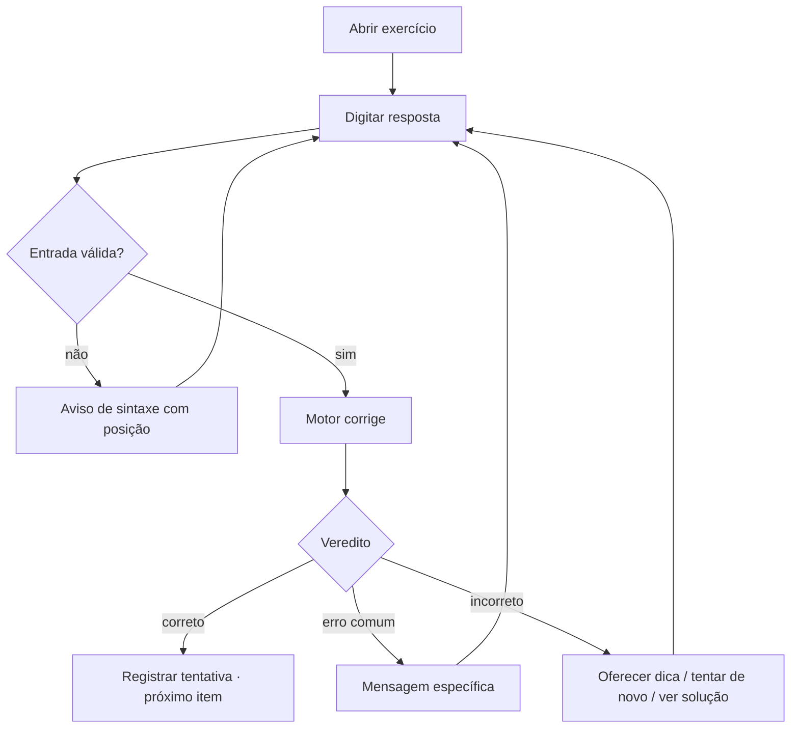
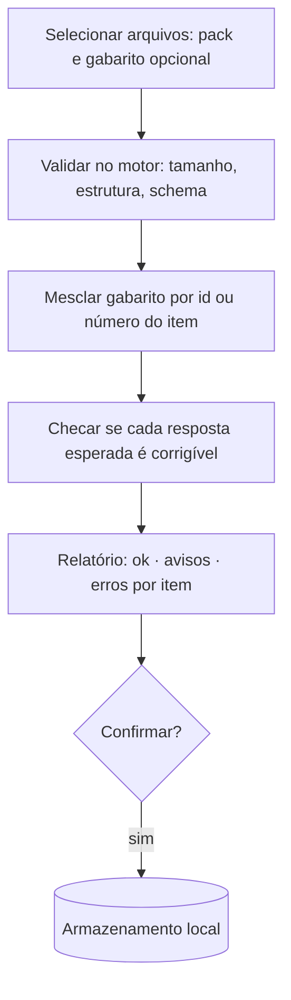

# PRD — Exercícios, Autoria e Importação (F1)

- **Status:** rascunho para a F1
- **Responsável:** product-manager (ver [AGENTS.md](../../AGENTS.md#papéis))
- **Relacionados:** [formato de exercícios](formato-de-exercicios.md) · [taxonomia](taxonomia.md) ·
  [ADR 0008](../03-arquitetura/adr/0008-formato-canonico-de-exercicio.md) ·
  [ADR 0009](../03-arquitetura/adr/0009-correcao-no-motor-rust.md) ·
  [ADR 0010](../03-arquitetura/adr/0010-local-first-na-fase-1.md)

## 1. Problema

Hoje o estudante resolve a lista no papel e confere no gabarito da última página do PDF. Isso tem
três falhas:
- só diz *se* errou, nunca *onde*;
- não aceita formas equivalentes (`5x − y = 16` vs. `y = 5x − 16`);
- não guarda nada, então os mesmos erros voltam na prova.

O Laboratório já sabe derivar, achar limites e resolver sistemas, mas não sabe que existe um
exercício para resolver.

## 2. Objetivos e métricas

| Objetivo | Métrica (medida localmente, sem telemetria por padrão) |
| -------- | ------------------------------------------------------ |
| Resolver listas reais com correção confiável | 100% dos itens corrigíveis da Lista 04 batem com o gabarito oficial (falso negativo = 0 no conjunto de aceite) |
| Aceitar formas equivalentes | Bateria de testes com ≥ 3 formas equivalentes por item de expressão/equação |
| Criar exercício rápido | Exercício de 2 partes criado no editor em < 3 min |
| Importar em lote | Pack com 20 exercícios + gabarito separado importado em < 10 s, com relatório de erros por item |
| Ligar prática e visualização | ≥ 50% dos exercícios de Cálculo/VGA com "Abrir no laboratório" |

## 3. Usuários e histórias

### Estudante
1. **Resolver um exercício.** Como estudante, quero digitar minha resposta com notação matemática
   e ver na hora se está certa, para não depender do gabarito.
   - Dado `f(x) = -x/(x²+1)`, quando respondo `0` para a inclinação em `x = 1`, recebo "correto".
   - Quando respondo `y = -0.5` ou `2y + 1 = 0` para a reta tangente, recebo "correto".
   - Quando a entrada não é válida (`2x +`), recebo um aviso de **sintaxe** (não "errado") e a
     posição do erro, e a tentativa não conta.
2. **Pedir dica.** Quero dicas em níveis (ideia → próximo passo → quase a resposta), para destravar
   sem ver tudo. O número de dicas usadas fica registrado na tentativa.
3. **Ver a solução.** Depois de tentar (ou desistir), quero a solução em passos, com os passos
   gerados pelo motor quando o exercício permitir (derivada regra por regra).
4. **Abrir no laboratório.** Num item com visualização, um botão abre o tópico do Laboratório já
   com a função e o ponto do exercício.
5. **Resolver uma lista.** Quero abrir "Lista 04 — Derivadas", ver o progresso (7/19), pular itens
   e voltar depois sem perder o que fiz.
6. **Exercícios sem correção automática.** Em esboços e demonstrações, quero ver a solução e
   marcar "acertei / errei / parcialmente", para o item entrar na revisão.
7. **Errar com explicação.** Quando minha resposta coincide com um erro comum cadastrado (ex.:
   derivada sem a regra da cadeia), quero ver a mensagem específica daquele erro.

### Autor (estudante, monitor, professor, colaborador)
8. **Criar exercício no editor.** Quero escrever o enunciado em Markdown + LaTeX com preview ao
   vivo, adicionar partes (a, b, c), escolher o tipo de resposta e testar a correção ali mesmo.
9. **Importar em lote.** Quero subir um pack (`.vertice.zip`, `.json` ou `.ex.md`) e, se houver,
   um gabarito separado (`gabarito.json` ou CSV `item,resposta`), e receber um relatório: quantos
   entraram, quais falharam e por quê (linha/campo).
10. **Exportar.** Quero exportar meus exercícios e listas como pack para compartilhar ou fazer backup.
11. **Privacidade.** Material de terceiros importado fica marcado como `private` e nunca é incluído
    em exportações públicas nem enviado a serviços externos sem confirmação explícita.

### Contribuidor do banco público
12. Quero adicionar exercícios autorais em `content/` por pull request, e a CI valida o schema,
    a licença e se a resposta esperada é corrigível pelo motor.

## 4. Escopo

**Na F1**
- Tipos de resposta: `numeric`, `expression`, `equation`, `set`, `tuple` (ponto/vetor), `matrix`,
  `choice` (única/múltipla), `matching`, `self_graded`. Detalhes em [formato-de-exercicios.md](formato-de-exercicios.md).
- Correção offline no motor (WASM/Tauri).
- Listas (coleções ordenadas), tags de habilidade, dificuldade, fonte e licença.
- Editor de autoria, importação de pack + gabarito, exportação, armazenamento local.

**Fora da F1** (fases seguintes)
- Importação de PDF com IA, dicas geradas por IA, tutor (F2).
- Exercícios de código e de SQL (F2).
- Questões aleatorizadas por parâmetros (F2; o formato já reserva `params`).
- Revisão FSRS, plano de estudos, progresso (F2).
- Contas, compartilhamento online, turmas (F3–F4).

## 5. Fluxos principais

## 6. Casos de borda
- Resposta equivalente mas fora do domínio de amostragem (ex.: `sqrt(x)` com `x < 0`) → o corretor
  amostra só no domínio declarado/inferido; ver ADR 0009.
- Exercício com mais de uma resposta correta (conjunto não ordenado, `±`).
- Itens com figura (ex.: associar gráficos às derivadas) → assets no pack; texto alternativo obrigatório.
- Gabarito sem correspondência de item → aviso, não erro fatal.
- Pack com o mesmo `id` de um exercício existente → perguntar: substituir, manter os dois (nova versão) ou pular.
- Unidades (`m/s`) e vírgula decimal (`1,5`) → aceitar ambos; unidades opcionais na F1.

## 7. Requisitos não funcionais
- Correção de um item em < 50 ms no navegador de um notebook comum.
- Funciona offline após o primeiro carregamento.
- Acessível: navegação por teclado, leitores de tela nos enunciados (MathML do KaTeX), contraste AA.
- Segurança: ver [modelo de ameaças](../06-seguranca/modelo-de-ameacas.md) (importação de packs e Markdown do usuário).

## 8. Perguntas em aberto
- Usar MathLive como campo de resposta ou evoluir o `ExpressionInput` atual? (spike na F1)
- Pontuação parcial por parte ou só por item?
- Quantas tentativas antes de liberar a solução (configurável por lista)?
