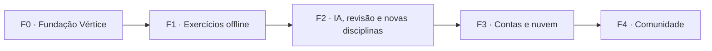

# Roadmap

Fases pequenas, cada uma entregando algo utilizável. Datas são intencionais, não promessas.
O histórico do Math View (v0.0–v0.3) continua no fim do arquivo.

## Executar com agentes de terminal

Use o [índice de implementação](../05-engenharia/implementacao/README.md) para escolher uma
unidade. Os guias especificam ordem, dependências, papéis, leituras, design, verificação e ponto
de parada. Este roadmap mantém o estado das entregas; os guias não significam trabalho concluído.

| Fase | Guia de execução | Unidades |
| ---- | ---------------- | -------- |
| F0 | [Fundação](../05-engenharia/implementacao/f0-fundacao.md) | F0.1–F0.7 |
| F1 | [Exercícios offline](../05-engenharia/implementacao/f1-exercicios.md) | F1.1–F1.10 |
| F2 | [Estudo local ampliado](../05-engenharia/implementacao/f2-estudo-local.md) | F2.1–F2.12 |
| F3 | [Contas e nuvem](../05-engenharia/implementacao/f3-contas-e-nuvem.md) | F3.1–F3.8 |
| F4 | [Comunidade](../05-engenharia/implementacao/f4-comunidade.md) | F4.1–F4.7 |

Prompt curto de exemplo: `Execute F0.1 conforme docs/05-engenharia/implementacao/f0-fundacao.md.`

Para UI, siga o [design aprovado](../05-engenharia/implementacao/design-aprovado.md): **Início A,
Exercício D e Site D**, todos na direção visual A. Recursos mostrados nos protótipos só entram
quando sua fase os implementar. O Site D pertence à F0; Exercício D e Início A funcional, à F1.

## F0 — Fundação Vértice
Objetivo: o repositório vira a plataforma, sem funcionalidade nova para o estudante.
- [x] Modelagem: visão, PRD de exercícios, formato, arquitetura, ADRs 0006–0012, segurança, DevOps, IA.
- [x] Agentes de desenvolvimento (`AGENTS.md`, `CLAUDE.md`, `.claude/agents`).
- [x] Material de terceiros fora do git (`content-private/`).
- [ ] Renome: repositório → `vertice`, crates `mv-*` → `vx-*`, pacotes `@math-view/*` → `@vertice/*`.
  Renome local concluído na F0.2; builds desktop debug e release Windows passaram com ícone
  provisório autorizado. Renome no GitHub e
  confirmação da identidade para publicação continuam pendentes; veja o
  [registro da F0.2](../05-engenharia/implementacao/f0-2-renome-tecnico.md).
- [x] Navegação por módulos; Laboratório em `/lab/...` com redirecionamento das rotas antigas.
  F0.4 verificada no build estático: sete tópicos, URLs antigas com parâmetros e fragmentos,
  histórico, tema, teclado e menu responsivo. Site D e comparação com a fonte visual não estão
  incluídos; veja o [relatório da F0.4](../05-engenharia/implementacao/f0-4-navegacao.md).
- [ ] Site D de produção, conforme ADR 0013, com demonstrações e recursos planejados identificados.
- [x] Atualizar dependências do front (Vite, SvelteKit, Vitest) e Rust.
  Atualização compatível da F0.3 verificada em Windows, WASM e build estático; Kit permanece
  na última versão 2.x consultada. Majors separadas, vulnerabilidade npm baixa restante,
  scanner Rust indisponível e falha 3D preexistente estão no
  [relatório da F0.3](../05-engenharia/implementacao/f0-3-dependencias.md).
- [ ] CI no GitHub Actions: fmt, clippy, testes, build WASM, lint, check + scanners de segurança
  ([ci-cd.md](../07-devops/ci-cd.md)).
  Configuração local da F0.6 implementada; execução em PR e configuração externa pendentes.
  Veja [evidências e limites](../05-engenharia/implementacao/f0-6-ci-seguranca.md).
- [ ] Deploy estático com preview por PR (Cloudflare).
- [ ] `SECURITY.md` publicado; modelo de ameaças v1 revisado.

## F1 — Exercícios offline (MVP)
Objetivo: resolver uma lista inteira com correção automática, sem conta e sem internet.
- [x] Tipos do exercício em Rust + JSON Schema gerado + tipos TS gerados ([ADR 0008](../03-arquitetura/adr/0008-formato-canonico-de-exercicio.md)); F1.1 verificada no [relatório de contratos](../05-engenharia/implementacao/f1-1-contratos.md), com fronteiras refinadas pelo ADR 0016.
- [x] Corretor no motor: numérico, expressão, equação, conjunto/lista, vetor/matriz, múltipla
  escolha, associação, autoavaliado ([ADR 0009](../03-arquitetura/adr/0009-correcao-no-motor-rust.md)).
  F1.2 verificada no [relatório de correção](../05-engenharia/implementacao/f1-2-correcao.md),
  incluindo `form` e paridade de 71 fixtures no nativo, WASM e IPC Tauri com runtime simulado.
  Autoavaliação não recebe correção automática; player e aceite completo continuam pendentes.
- [ ] Compilador `*.ex.md` → JSON canônico; pasta `content/` com índice e busca local.
- [ ] Verificação independente do gabarito, `verify`, evidência com escopo e versão, selo derivado
  e `content/evidence.lock.json` validado na CI ([ADR 0015](../03-arquitetura/adr/0015-evidencia-de-verificacao.md)).
- [ ] Player de exercício e de lista; dicas; solução em passos; "Abrir no laboratório".
- [ ] Editor de autoria com preview.
- [ ] Importação de pack (`.vertice.zip`, JSON, Markdown) com gabarito opcional separado; CSV para objetivas.
- [ ] Armazenamento local (IndexedDB na web, SQLite no desktop), exportação/backup em JSON
  ([ADR 0010](../03-arquitetura/adr/0010-local-first-na-fase-1.md)).
- [ ] Primeiros exercícios autorais públicos de Cálculo e VGA (CC BY-SA).
- [ ] **Biblioteca, parte 1:** `references[]` nos exercícios (título, tipo, fonte, licença, link),
  seção "Para estudar" no player e validação na CI. Sem leitor nem upload
  ([PRD da Biblioteca](prd-biblioteca.md), ADR 0014).

**Critério de aceite:** a Lista 04 de Derivadas inteira, modelada como **pack privado**, pode ser
resolvida no app e cada item corrigido bate com o gabarito oficial.

## F2 — IA, revisão e novas disciplinas
- [ ] Importador de PDF assistido por IA com revisão humana e checagem do gabarito pelo motor ([estratégia de IA](../08-ia/estrategia-ia.md)).
- [ ] Dicas e tutor socrático fundamentados nos passos do motor.
- [ ] Servidor MCP `vertice-mcp` (motor + busca de exercícios como ferramentas).
- [ ] Revisão FSRS, caderno de erros, plano de estudos com data de prova, Progresso local.
- [ ] Física I, Métodos numéricos, Estruturas I (AU), Algoritmos e SQL no navegador.
- [ ] Exercícios de código (JS/Python/SQL no navegador; Java em avaliação).
- [ ] **Biblioteca local** ([PRD](prd-biblioteca.md), ADR 0014): arquivo próprio (PDF) **só no
  dispositivo**, como os packs privados; leitor com busca e retomada; destaques e notas, e destaque
  → cartão FSRS; vínculo de material a habilidades; **roteiros de leitura** autorais em `content/`;
  catálogo de fontes abertas **por link** (licença conferida por item e edição); selo de confiança
  e status (ativo, corrigido, retirado) com errata; busca local e backup. Antes: revisão de
  segurança de PDF e Markdown do usuário.

## F3 — Contas e nuvem
- [ ] `vx-server` (Axum) com os mesmos casos de uso; Postgres + pgvector; assets no R2 ([ADR 0011](../03-arquitetura/adr/0011-backend-axum-postgres.md)).
- [ ] Autenticação OIDC com passkeys; ASVS 5.0 nível 2.
- [ ] Sincronização local ↔ nuvem (ADR próprio), listas compartilhadas por link.
- [ ] Infra como código (OpenTofu), Oracle ARM + Cloudflare, observabilidade, backups ([infra](../07-devops/infra-free-tier.md)).
- [ ] Judge de código no servidor (sandbox isolada) se a F2 mostrar necessidade.
- [ ] **Biblioteca na nuvem:** sincronização de metadados, destaques, notas e progresso; arquivos
  **autorais** em nuvem **privada**, com cota por usuário e exclusão total ao sair. Arquivo de
  terceiros nunca sobe: fica só no dispositivo ([PRD](prd-biblioteca.md)).

## F4 — Comunidade
- [ ] Grupos e turmas; professor/monitor publica listas para a turma.
- [ ] Publicação de packs públicos com revisão/moderação e licença explícita.
- [ ] Reputação, comentários em exercícios, exportação QTI 3.0, LTI para LMS.
- [ ] **Biblioteca na comunidade:** compartilhar em grupos **só conteúdo autoral** (autor declara a
  autoria e escolhe licença aberta); material de terceiros só como **link + metadados**, nunca como
  arquivo hospedado. **Pré-requisitos para abrir o upload compartilhado:** processo de denúncia e
  remoção (notice and takedown, alinhado ao Marco Civil da Internet e à Lei 9.610/98), termos de
  uso, fila de moderação e **avaliação jurídica**. Licença padrão: CC BY-SA 4.0 (CC BY e CC0 como
  opções). Ver [PRD](prd-biblioteca.md).

## Pontos em aberto
- Execução de Java no navegador vs. judge no servidor (decidir na F2).
- Engine de sync (Zero, Electric + PGlite, PowerSync ou próprio) — ADR na F3.
- IdP (Zitadel, Authentik, Keycloak, Ory) vs. sessões próprias no Axum — ADR na F3.
- Escopo npm `@vertice` e domínio — confirmar disponibilidade antes do renome.
- Biblioteca: quem faz a avaliação jurídica (antes da F4) e a política durante a análise de uma
  denúncia; ver os pontos em aberto do [PRD da Biblioteca](prd-biblioteca.md#12-pontos-em-aberto).

---

## Histórico — Math View

### v0.0 — Fundação ✅
Documentação, Clean Architecture, esqueleto de crates e do app web/desktop.

### v0.1 — "Tangente viva" ✅
Parser Pratt, `GraphCanvas` com zoom e pan, ponto arrastável, tangente, rastro de `f'`, tema claro/escuro.

### v0.2 — Cálculo A ✅
Limites e continuidade, derivadas com regras, integrais com Riemann e TFC, funções por partes,
erros estruturados (`ApiError`, [ADR 0005](../03-arquitetura/adr/0005-mv-api-dispatch-unico.md)), resultados exatos.

### v0.3 — Vetores e Geometria Analítica ✅
Operações com vetores em 3D, retas e planos, matrizes, sistemas lineares.

### Itens herdados (entram na F1–F2 conforme prioridade)
- Derivação passo a passo de `f''` e simplificação mais forte (fatoração).
- Integração por substituição e por partes com passos.
- Cônicas e quádricas; transformações lineares no plano.
- Amostragem adaptativa de curvas.
- Workspaces `.vertice`, exportar PNG/SVG, command palette; build Tauri no CI.
