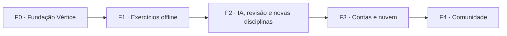

# Roadmap

Fases pequenas, cada uma entregando algo utilizável. Datas são intencionais, não promessas.
O histórico do Math View (v0.0–v0.3) continua no fim do arquivo.

## F0 — Fundação Vértice
Objetivo: o repositório vira a plataforma, sem funcionalidade nova para o estudante.
- [x] Modelagem: visão, PRD de exercícios, formato, arquitetura, ADRs 0006–0012, segurança, DevOps, IA.
- [x] Agentes de desenvolvimento (`AGENTS.md`, `CLAUDE.md`, `.claude/agents`).
- [x] Material de terceiros fora do git (`content-private/`).
- [ ] Renome: repositório → `vertice`, crates `mv-*` → `vx-*`, pacotes `@math-view/*` → `@vertice/*`.
- [ ] Navegação por módulos; Laboratório em `/lab/...` com redirecionamento das rotas antigas.
- [ ] Atualizar dependências do front (Vite, SvelteKit, Vitest) e Rust.
- [ ] CI no GitHub Actions: fmt, clippy, testes, build WASM, lint, check + scanners de segurança
  ([ci-cd.md](../07-devops/ci-cd.md)).
- [ ] Deploy estático com preview por PR (Cloudflare).
- [ ] `SECURITY.md` publicado; modelo de ameaças v1 revisado.

## F1 — Exercícios offline (MVP)
Objetivo: resolver uma lista inteira com correção automática, sem conta e sem internet.
- [ ] Tipos do exercício em Rust + JSON Schema gerado + tipos TS gerados ([ADR 0008](../03-arquitetura/adr/0008-formato-canonico-de-exercicio.md)).
- [ ] Corretor no motor: numérico, expressão, equação, conjunto/lista, vetor/matriz, múltipla
  escolha, associação, autoavaliado ([ADR 0009](../03-arquitetura/adr/0009-correcao-no-motor-rust.md)).
- [ ] Compilador `*.ex.md` → JSON canônico; pasta `content/` com índice e busca local.
- [ ] Player de exercício e de lista; dicas; solução em passos; "Abrir no laboratório".
- [ ] Editor de autoria com preview.
- [ ] Importação de pack (`.vertice.zip`, JSON, Markdown) com gabarito opcional separado; CSV para objetivas.
- [ ] Armazenamento local (IndexedDB na web, SQLite no desktop), exportação/backup em JSON
  ([ADR 0010](../03-arquitetura/adr/0010-local-first-na-fase-1.md)).
- [ ] Primeiros exercícios autorais públicos de Cálculo e VGA (CC BY-SA).

**Critério de aceite:** a Lista 04 de Derivadas inteira, modelada como **pack privado**, pode ser
resolvida no app e cada item corrigido bate com o gabarito oficial.

## F2 — IA, revisão e novas disciplinas
- [ ] Importador de PDF assistido por IA com revisão humana e checagem do gabarito pelo motor ([estratégia de IA](../08-ia/estrategia-ia.md)).
- [ ] Dicas e tutor socrático fundamentados nos passos do motor.
- [ ] Servidor MCP `vertice-mcp` (motor + busca de exercícios como ferramentas).
- [ ] Revisão FSRS, caderno de erros, plano de estudos com data de prova, Progresso local.
- [ ] Física I, Métodos numéricos, Estruturas I (AU), Algoritmos e SQL no navegador.
- [ ] Exercícios de código (JS/Python/SQL no navegador; Java em avaliação).

## F3 — Contas e nuvem
- [ ] `vx-server` (Axum) com os mesmos casos de uso; Postgres + pgvector; assets no R2 ([ADR 0011](../03-arquitetura/adr/0011-backend-axum-postgres.md)).
- [ ] Autenticação OIDC com passkeys; ASVS 5.0 nível 2.
- [ ] Sincronização local ↔ nuvem (ADR próprio), listas compartilhadas por link.
- [ ] Infra como código (OpenTofu), Oracle ARM + Cloudflare, observabilidade, backups ([infra](../07-devops/infra-free-tier.md)).
- [ ] Judge de código no servidor (sandbox isolada) se a F2 mostrar necessidade.

## F4 — Comunidade
- [ ] Grupos e turmas; professor/monitor publica listas para a turma.
- [ ] Publicação de packs públicos com revisão/moderação e licença explícita.
- [ ] Reputação, comentários em exercícios, exportação QTI 3.0, LTI para LMS.

## Pontos em aberto
- Execução de Java no navegador vs. judge no servidor (decidir na F2).
- Engine de sync (Zero, Electric + PGlite, PowerSync ou próprio) — ADR na F3.
- IdP (Zitadel, Authentik, Keycloak, Ory) vs. sessões próprias no Axum — ADR na F3.
- Escopo npm `@vertice` e domínio — confirmar disponibilidade antes do renome.

---

## Histórico — Math View

### v0.0 — Fundação ✅
Documentação, Clean Architecture, esqueleto de crates e do app web/desktop.

### v0.1 — "Tangente viva" ✅
Parser Pratt, `GraphCanvas` com zoom e pan, ponto arrastável, tangente, rastro de `f'`, tema claro/escuro.

### v0.2 — Cálculo A ✅
Limites e continuidade, derivadas com regras, integrais com Riemann e TFC, funções por partes,
erros estruturados (`ApiError`, [ADR 0005](../03-arquitetura/adr/0005-mv-api-dispatch-unico.md)), resultados exatos.

### v0.3 — Vetores e Geometria Analítica ✅
Operações com vetores em 3D, retas e planos, matrizes, sistemas lineares.

### Itens herdados (entram na F1–F2 conforme prioridade)
- Derivação passo a passo de `f''` e simplificação mais forte (fatoração).
- Integração por substituição e por partes com passos.
- Cônicas e quádricas; transformações lineares no plano.
- Amostragem adaptativa de curvas.
- Workspaces `.vertice`, exportar PNG/SVG, command palette; build Tauri no CI.
