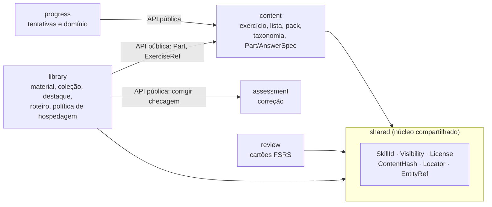
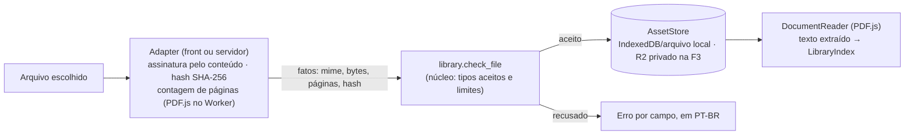

# ADR 0014 — Biblioteca: contexto `library`, material de estudo e roteiros de leitura

- **Status:** aceito pelo mantenedor em 2026-10-15
- **Data:** 2026-10-15
- **Relacionados:** [PRD da Biblioteca](../../02-produto/prd-biblioteca.md) ·
  [ADR 0007](0007-contextos-como-modulos.md) · [ADR 0008](0008-formato-canonico-de-exercicio.md) ·
  [ADR 0010](0010-local-first-na-fase-1.md) · [ADR 0011](0011-backend-axum-postgres.md) ·
  [ADR 0012](0012-conteudo-de-terceiros-e-licencas.md) ·
  [ADR 0015](0015-evidencia-de-verificacao.md) ·
  [pesquisa OpenAI Math](../../09-pesquisa/openai-math.md#modelo-de-catálogo-para-a-biblioteca)

## Contexto

O mantenedor decidiu criar o módulo **Biblioteca** (rota `/biblioteca`) com material de estudo:
papers (link e metadados), livros abertos, notas de aula autorais, arquivos próprios do usuário
(PDF), vídeos (link) e **roteiros de leitura** (material, pré-requisitos, perguntas de checagem,
exercícios e "Abrir no laboratório"). Já estão decididas, e este ADR não as reabre:

- **F1:** só `references[]` nos exercícios. **F2:** Biblioteca local. **F3:** upload para nuvem
  privada (R2) e sincronização. **F4:** compartilhamento em grupos.
- Na comunidade, **só conteúdo autoral** é compartilhável, com autoria declarada e licença aberta.
  Material de terceiros fica privado/local ou entra como **link e metadados** (DOI, arXiv, URL),
  nunca como arquivo hospedado. *Notice and takedown* é pré-requisito da F4.
- Todo material se liga a habilidades da [taxonomia](../../02-produto/taxonomia.md).
- Decisões do mantenedor de 2026-10-15, sobre os pontos em aberto do PRD:
  - licença padrão para compartilhar conteúdo autoral na F4: CC BY-SA 4.0, com CC BY 4.0 e CC0
    como opções;
  - na F3, arquivo de terceiros **nunca** sobe para a nuvem, nem como cópia privada: só metadados,
    anotações e destaques sincronizam. Arquivos autorais do usuário podem subir para o R2 privado;
  - a avaliação jurídica acontece antes da F4 e não bloqueia a F3;
  - na F2, o cartão de revisão criado a partir de destaque é só manual, sem sugestão por IA.

O PRD deixa para a arquitetura (pontos 6 a 11): modelo de dados, formatos, armazenamento de
arquivos e anotações, onde fica o contexto no código, limites de upload, leitor de PDF, destaque
estável entre edições, consulta de metadados, registro do selo "verificado pelo motor",
versionamento e retenção, e granularidade do vínculo com habilidades.

Forças e restrições:
- **Mesmo núcleo em todo lugar** e **local-first** ([ADR 0010](0010-local-first-na-fase-1.md)):
  regras de licença, de hospedagem e de status precisam rodar no navegador, no desktop e no
  `vx-server`.
- **Um contrato** ([ADR 0008](0008-formato-canonico-de-exercicio.md)): tipos Rust → JSON Schema →
  tipos TS. O `dispatch` ([ADR 0005](0005-mv-api-dispatch-unico.md)) troca JSON; arquivos binários
  de dezenas de MB não cabem bem nesse canal.
- O modelo de dados atual dá ao `ReviewCard` a identidade `exerciseId + partLabel`. Um destaque não
  é parte de exercício, mas precisa virar cartão FSRS. O contexto `review` ainda não foi
  implementado (F2), então não há dado a migrar.
- Material de terceiros tem direitos autorais ([ADR 0012](0012-conteudo-de-terceiros-e-licencas.md)).
  Licenças NC são incompatíveis com a CC BY-SA 4.0 de `content/`.
- **Correção ao exemplo do ADR 0012.** O ADR 0012 cita "OpenStax CC BY" como fonte aberta
  compatível. Esse exemplo não vale para toda a OpenStax. Os três volumes de *Calculus* são
  **CC BY-NC-SA 4.0** e, portanto, entram só como link
  ([prefácio do Volume 1](https://openstax.org/books/calculus-volume-1/pages/preface)). Outros
  títulos têm licenças diferentes e precisam ser conferidos um a um. A licença também pode mudar
  entre edições da mesma obra. O *Active Calculus*, por exemplo, teve edições antigas em
  CC BY-NC-SA 3.0 e edições posteriores em CC BY-SA 4.0. Por isso a licença é registrada **por
  edição** (por `Material`), nunca por obra. O ADR 0012 não é reescrito; este ADR registra a
  correção.
- A lista do que alguém lê é dado sensível; PDFs, EPUBs e Markdown do usuário são entrada não
  confiável ([modelo de ameaças, T7](../../06-seguranca/modelo-de-ameacas.md#t7--upload-e-leitura-de-arquivos-f2f4)).
- Free tier: o R2 gratuito tem 10 GB de armazenamento no total, para todos os usuários.

O repositório OpenAI Math mostrou práticas úteis para um catálogo que recebe correções: famílias de
documentos, citação por manuscrito, histórico de retiradas e correções com versões antigas
acessíveis, catálogo com schema declarado e aviso de conteúdo gerado por IA.

## Decisão

### 1. Contexto `library` como módulo dentro das camadas

Segue o [ADR 0007](0007-contextos-como-modulos.md): **não** é crate nova.

| Camada | Onde |
| ------ | ---- |
| Domínio | `vx-domain/src/library/` — `Material`, `Collection`, `Highlight`, `ReadingGuide`, política de licença e hospedagem, status por errata, selos |
| Aplicação | `vx-application/src/use_cases/library/` — `AddMaterial`, `ImportMaterialFile`, `CreateHighlight`, `CompileReadingGuide`, `CheckSharePolicy` (F4)… e os ports |
| Adaptadores | `vx-infra` (parser de frontmatter compartilhado, BibTeX ↔ CSL); `vx-api/src/library.rs` (comandos `library.*` no mesmo `dispatch`) |
| Front | `lib/domain/library.ts`, `lib/ports/{material-repository,highlight-repository,reading-guide-repository,library-index,document-reader,metadata-lookup}.ts`, `lib/adapters/library/`, `lib/adapters/documents/pdfjs-reader.ts`, `lib/application/{library-shelf,reader-session,guide-player}.svelte.ts`, `lib/ui/library/`, rotas em `src/routes/biblioteca/` |

Comandos iniciais (F2): `library.compile` (`*.mat.md`/`*.guide.md` → canônico),
`library.validate_material`, `library.validate_guide`, `library.check_file` (valida os **fatos**
de um arquivo, ver §6), `library.trust_badges`. Na F4, `library.share_policy`.

### 2. Fronteiras com os outros contextos



- **Núcleo compartilhado `shared`** (`vx-domain/src/shared/`, a partir da F1): tipos de valor
  pequenos e estáveis usados por mais de um contexto, sem regra de negócio de nenhum deles:
  `SkillId` (caminho da taxonomia), `Visibility`, `License` (identificador SPDX, `proprietary` ou
  `unknown`, com a **tabela de compatibilidade** com CC BY-SA 4.0), `ContentHash` (`sha256:<hex>`),
  `Locator` (página, seção, intervalo de tempo) e `EntityRef` (tipo + UUID). A regra do
  [ADR 0012](0012-conteudo-de-terceiros-e-licencas.md) ("`proprietary` nunca vira `public`")
  continua no `content`, mas usa a tabela de `shared`. Qualquer tipo novo em `shared` passa por
  revisão do `software-architect`.
- **`content`** continua dono de exercício, lista, pack, taxonomia e do formato `*.ex.md`. A
  `library` referencia exercícios por `ExerciseRef { id, parts? }` e reutiliza o tipo público
  `Part` (com `AnswerSpec`) nas perguntas de checagem dos roteiros. A taxonomia chega à `library`
  por um port (`SkillCatalog`), não por import dos internos de `content`.
- **`assessment`** corrige as perguntas de checagem com o mesmo `assessment.check`. A `library`
  nunca decide um veredito.
- **`review`** passa a agendar cartões com **alvo polimórfico** (§5) e não importa nada da
  `library`: a origem de um cartão é um `EntityRef` de `shared`.
- **`progress`**: domínio por habilidade continua vindo **só de tentativas em exercícios**. Ler um
  material ou concluir uma etapa de roteiro fica no estado do roteiro (`GuideProgress`, na
  `library`) e não conta como domínio na F2. Respostas às checagens também não; para contar, a
  checagem deve virar exercício.
- **Validação cruzada** (o roteiro aponta para exercício e habilidade que existem; o material
  público não tem arquivo de terceiros) roda no **driver** `vertice content build`: ele compila
  `content` e `library` e depois chama `library.check_references` com o índice público exportado
  pelo `content`. Nenhum contexto importa o outro para isso.
- O **teste de arquitetura** previsto no ADR 0007 (lista de `use` permitidos por contexto) passa a
  ser obrigatório antes do primeiro código da `library`.

### 3. Entidades

Detalhes de campos e SQL em [modelo-de-dados.md](../modelo-de-dados.md). Formatos em
[formato-de-exercicios.md](../../02-produto/formato-de-exercicios.md#13-biblioteca-materiais-e-roteiros-f2).

- **`Material`** — UUIDv7 + `revision` (imutável por revisão, como o exercício).
  - `kind`: `paper | book | notes | document | video | webpage`.
  - `title`, `locale`, metadados de citação em **CSL-JSON** (autores, ano, editora, edição,
    `DOI`, `ISBN`, `URL`, versão) e `arxiv`.
  - `origin`: `authored | open | third_party`.
  - `hosting`: `link | inline | file`.
  - `rights { license, url?, checkedAt?, aiUse: allowed | forbidden | unknown }`.
  - `visibility: public | private`.
  - `skills[]` + `sections[] { locator, skills[] }` opcionais.
  - `aiGenerated`, `review { by, at }?`, `errata[]`.
  - Cada **edição** com licença própria é um `Material` diferente; as edições se agrupam numa
    coleção (`kind: editions`).
- **`Asset`** — arquivo identificado pelo **hash do conteúdo** (`sha256` dos bytes guardados), com
  `mime` **detectado pelo conteúdo**, tamanho e número de páginas. `MaterialFile` liga uma revisão
  do material a um asset. O nome original do arquivo nunca é identidade nem sai do dispositivo.
  O `AssetStore` do ADR 0010 passa a ser endereçado por conteúdo e serve também aos assets de
  exercícios.
- **`Collection`** — a "família" do OpenAI Math: UUIDv7, `kind: family | editions`, itens
  ordenados (`material`, `guide`, `exercise` ou `list`) com papel (`main`, `companion`,
  `prerequisite`, `alternative`, `edition`).
- **`Highlight`** — UUIDv7, aponta para `materialId + revision` e para o `ContentHash` do arquivo
  lido. A posição usa o **W3C Web Annotation Data Model**:
  - `TextQuoteSelector { exact, prefix, suffix }` + `TextPositionSelector` + página, para PDF e
    texto;
  - `FragmentSelector` com *media fragment* `t=início,fim`, para vídeo.

  Tem `color`, `note` (Markdown, sanitizado) e herda a visibilidade do material.

  **Reancoragem entre edições do arquivo.** Ao abrir um material, o leitor tenta posicionar cada
  destaque nesta ordem:
  1. Mesmo `ContentHash`: usa a posição gravada (página + `TextPositionSelector`). É exato.
  2. Hash diferente (outra edição ou outro arquivo da mesma revisão): procura o `exact` na página
     gravada e nas vizinhas, desempatando por `prefix`/`suffix`, e depois no documento inteiro.
     Se achar, mostra o aviso "posição pode ter mudado" até o usuário confirmar.
  3. Não achou: o destaque fica **órfão**. Continua na lista com o trecho citado e a nota, sem
     posição, e nunca é apagado automaticamente.

  O `ContentHash` só serve para saber se o arquivo é o mesmo. A identidade do destaque é o UUID.

  **A âncora não depende do arquivo no servidor.** Na F3, o arquivo de terceiros fica só no
  dispositivo, mas destaques e anotações sincronizam. Por isso o destaque é autossuficiente: leva
  `ContentHash`, trecho citado (`exact`, `prefix`, `suffix`), posição e página. Em outro
  dispositivo, o material sincronizado aparece "sem arquivo neste dispositivo". Quando o usuário
  adiciona um arquivo local, o app calcula o hash e o **re-associa** ao material:
  - hash igual: os destaques reancoram exatamente;
  - hash diferente: o app oferece associar mesmo assim e reancorar pela citação (passo 2 acima).

  O trecho citado de material de terceiros sincroniza como dado **privado** do dono (é a anotação
  dele) e nunca é compartilhado.
- **`ReadingGuide`** — UUIDv7 + `revision`, com `skills[]`, `prerequisites { skills[], guides[] }`,
  `estimatedMinutes`, `source`, selos e errata. Tem `steps[]`, cada um com `id` estável e:
  - texto de orientação;
  - `read { material, locator }?`;
  - `questions[]` abertas;
  - `checks[]`, cada uma uma `Part` com `AnswerSpec`, `verify` e `onMiss { step | skill }`;
  - `exercises[]` (`ExerciseRef`);
  - `viz { id, params }?`.

  `GuideProgress` (local) guarda as etapas concluídas por `guideId + revision`.
- **Selos** são **derivados**, nunca gravados à mão (função de domínio `trust_badges`):
  - `authored` e `open_source` vêm de `origin`;
  - `ai_generated` vem de `aiGenerated`;
  - `reviewed` exige `review.by` e `review.at`;
  - `engine_verified` vem das evidências do [ADR 0015](0015-evidencia-de-verificacao.md) e vale
    **só** para checagens e exercícios, nunca para texto explicativo.

  Selos de packs importados são recalculados localmente, e "revisado" mostra quem declarou.
- **Status** também é derivado do registro de errata, que só recebe acréscimos (`errata[]`, como
  o `history.md` do OpenAI Math). Fica `active` sem entradas, `corrected` quando há correção que
  gerou nova revisão e `retracted` quando há retirada. Cada retirada tem
  `reason: error | copyright | author_request | other` e `replacedBy?`.

### 4. Política de licença e hospedagem (regra de domínio, testada)

| `origin` | `hosting` permitido em `content/` (público) | Privado / local | Compartilhar em grupo (F4) |
| -------- | ------------------------------------------- | --------------- | -------------------------- |
| `authored` | `inline` ou `file`, licença **CC-BY-SA-4.0** | qualquer | sim, com autoria declarada e licença da lista aberta |
| `open` (licença compatível: CC0, CC BY, CC BY-SA) | **só `link`**; texto adaptado vira nota `authored` com atribuição, como no ADR 0012 item 2 | qualquer | só `link` |
| `open` com NC/ND, `third_party`, `proprietary`, `unknown` | **só `link`** | qualquer | só `link` |

- **Arquivo de terceiros nunca é hospedado** em `content/`, no R2 (nem como cópia privada) ou em
  grupo, qualquer que seja a licença. A CI falha se um material não autoral em `content/` tiver `file`
  ou `inline`.
- Metadados bibliográficos (título, autores, DOI) são fatos e podem ser públicos. **Resumos de
  editora não são copiados**; o corpo de um `*.mat.md` público é um resumo autoral.
- `aiUse: forbidden` impede qualquer envio a LLM. `unknown` e `private` exigem confirmação por
  ação ([estratégia de IA](../../08-ia/estrategia-ia.md)).
- **Licenças para compartilhar conteúdo autoral na F4** (decisão do mantenedor, 2026-10-15): o
  padrão é **CC BY-SA 4.0**, com **CC BY 4.0** e **CC0 1.0** como opções. A lista é uma constante
  do domínio, testada; qualquer outra licença bloqueia o compartilhamento.
- **Arquivo de terceiros nunca sobe para a nuvem**, nem como cópia privada na F3 (decisão do
  mantenedor). A regra `can_upload(material)` só aceita `origin = authored`.

### 5. Destaque vira cartão: `ReviewCard` com alvo polimórfico

```text
ReviewCard {
  id: UUIDv7,
  target:
    | { kind: "exercise_part", exerciseId, partLabel }          // corrigido pelo motor no player
    | { kind: "note", front, back, origin?: EntityRef + Locator } // autoavaliado (Again/Hard/Good/Easy)
  visibility,                                                    // herdada da origem
  fsrs: { due, stability, difficulty, reps, lapses, state }
}
```

- `exercise_part` mantém a regra antiga como restrição de unicidade: um cartão por
  `exerciseId + partLabel`.
- `note` guarda **cópia** da frente e do verso. O cartão sobrevive à exclusão do destaque ou do
  material, que vira "origem indisponível" (PRD, B5 e B6). Na F2 há no máximo um cartão por
  destaque.
- Na F2, frente e verso são escritos **pelo usuário** (decisão do mantenedor). Não há sugestão de
  pergunta por IA, então a criação do cartão não usa o port `LlmProvider`.
- Um cartão de origem privada é privado e nunca entra em exportação pública nem em grupo.
- Alvos futuros (por exemplo, `guide_check`) entram como novas variantes, com teste de contrato.

### 6. Arquivos: o binário não passa pelo `dispatch`



- Leitura de bytes, detecção de tipo e hash ficam em **adapters** (Web Crypto e PDF.js no front;
  Rust no `vx-server`). As **regras** (tipos aceitos, limites, política) ficam no domínio da
  `library`, e o adapter só entrega fatos. O servidor refaz tudo; nunca confia no cliente.
- **F2:** tipo de arquivo aceito: **PDF**, mais imagens PNG/JPEG/WebP dentro de notas. EPUB e HTML
  dependem do PRD (ponto 13) e, se entrarem, seguem a sanitização da T7. Limites iniciais: 100 MB
  e 2.000 páginas por PDF; 5 MB por imagem. Antes de importar, o app consulta a cota com
  `navigator.storage.estimate()`.
- **Leitor:** PDF.js (`pdfjs-dist`, Apache-2.0) só no adapter, com Worker dedicado,
  `isEvalSupported: false`, `enableScripting: false`, `enableXfa: false`, sem formulários e numa
  versão posterior à correção da CVE-2024-4367. A UI recebe um `DocumentView` pelo port
  `DocumentReader` e não importa o PDF.js.
- **Metadados de privacidade** (Info/XMP do PDF, EXIF/GPS de imagens) são removidos **em toda
  saída do dispositivo**: exportação, upload (F3) e compartilhamento (F4). A cópia local do
  usuário fica intacta.
- **Dois hashes.** O `ContentHash` do asset local (bytes originais) é o que ancora destaques e
  re-associa o arquivo entre dispositivos. A cópia que sai sem metadados (upload autoral na F3,
  exportação) tem hash próprio, registrado no asset remoto, e aponta para o hash local de origem.

### 7. Busca

- **F2, local:** **MiniSearch** nos dois alvos (web e Tauri, os dois rodam a mesma UI), com índice
  serializado no armazenamento local. O índice cobre metadados, notas, anotações e o texto extraído
  dos PDFs (extração incremental no Worker). Índices **público** e **privado** ficam separados
  (OWASP LLM08). O port `LibraryIndex` permite trocar por SQLite FTS5 no desktop se a medição pedir.
- **F2+, semântica:** opcional, já prevista na [estratégia de IA](../../08-ia/estrategia-ia.md),
  com `transformers.js` local.
- **F3:** Postgres FTS (`tsvector` com configuração `portuguese` e `unaccent`) + `pgvector`, só
  para o que o usuário sincronizou.

### 8. Citação e consulta de metadados

- O canônico é **CSL-JSON**: é JSON, cabe no contrato gerado e é o formato de entrada de
  processadores de citação. BibTeX entra e sai por adapter em `vx-infra`. Se a exportação BibTeX
  vai para a UI é decisão de produto (PRD, ponto 14).
- **Consulta por DOI ou arXiv** (Crossref e API do arXiv) só acontece por **ação explícita**
  ("Preencher"). A tela informa qual serviço recebe o identificador. Só o identificador é enviado,
  nunca conteúdo de arquivo. Na web, a chamada sai direto do navegador quando o serviço permite
  CORS; no desktop, por um comando Tauri com *allowlist* de hosts; na F3, pelo servidor com
  *allowlist* e cache (SSRF). Sem resposta, o preenchimento é manual.

**Resultado do spike de 2026-10-15:** a API HTTPS do arXiv respondeu HTTP 200, mas não enviou
`Access-Control-Allow-Origin`; o Chromium bloqueou o `fetch` entre origens. Portanto, a F2 web
usa preenchimento **manual para arXiv**. No desktop, a consulta continua prevista por comando
Tauri; ela ainda não foi implementada. Essa medição não avalia o Crossref. O
[relatório do spike](../../09-pesquisa/spike-arxiv-cors.md) registra controles, evidência e
reprodução. Reavalie CORS antes de habilitar consulta direta na web.

### 9. Formatos de autoria

Análogos ao `*.ex.md`, compilados pelo mesmo `vertice content build`, com o mesmo parser de
frontmatter em `vx-infra`:
- `content/library/materials/**/*.mat.md`: frontmatter com o `Material`; corpo com a nota
  (`inline`) ou um resumo autoral.
- `content/library/guides/**/*.guide.md`: frontmatter com o roteiro; blocos `::: step <id>`.
- `content/library/collections/*.yaml`: coleções.

A CI exige que `revision` aumente quando o canônico de um item muda. Também valida licença, selos
e referências cruzadas (§2).

### 10. Versões, errata e retirada

- Revisões são imutáveis. Localmente, todas ficam no banco; na F3, no Postgres. Em `content/`, o
  build liga cada entrada de errata ao *permalink* do commit da revisão anterior, e isso conta como
  versão antiga acessível.
- **Retirada por direitos autorais** apaga os assets e o corpo de **todas** as revisões e mantém só
  a lápide: título, motivo, data e substituto. Em `content/`, se o material chegou a ser publicado,
  pode exigir reescrita do histórico do git, como no precedente do ADR 0012.
- Destaques e cartões do usuário sobre item retirado continuam dele, com aviso (PRD, B12).

### 11. Habilidades

- Material **público** (`content/`) e material **compartilhado** (F4) exigem pelo menos uma
  habilidade existente na taxonomia, e a CI valida isso.
- Material **privado** pode ficar `unclassified` (zero habilidades). Nesse caso não alimenta
  recomendação (PRD, B8).
- A granularidade é o item inteiro, mais `sections[]` opcionais com `Locator` (capítulo, seção,
  intervalo de páginas ou de tempo).

### 12. Por fase

| Fase | Entra |
| ---- | ----- |
| F1 | `shared` (SkillId, License, Visibility); `references[]` no exercício (só metadados e link, sem arquivo) validado pela CI; seção "Para estudar" |
| F2 | Contexto `library` completo e local: `*.mat.md`, `*.guide.md`, coleções; leitor PDF.js; destaques; cartão `note`; busca MiniSearch; consulta de metadados sob ação; backup com arquivos opcionais |
| F3 | Sincronização de metadados, destaques, anotações e progresso de **todos** os materiais. Upload para R2 **privado** só de arquivos **autorais** do usuário, por item e sob opt-in, com varredura ClamAV, URLs pré-assinadas e cota por usuário. Arquivo de terceiros **nunca** sobe; em outro dispositivo, ele é re-associado localmente pelo hash (§3) |
| F4 | Compartilhar autoral em grupo (nova `visibility`, ADR próprio) sob CC BY-SA 4.0 (padrão), CC BY 4.0 ou CC0; denúncia e remoção; trilha de auditoria; *denylist* de hashes retirados. **Pré-requisito:** avaliação jurídica concluída antes da F4 (não bloqueia a F3) |

## Alternativas consideradas

- **Crate `vx-library`.** O compilador forçaria a fronteira. Por outro lado, multiplica
  `Cargo.toml` e DTOs, e o ADR 0007 já recusou esse caminho para um time pequeno. Pode ser revisto
  se a Biblioteca ganhar ritmo próprio.
- **Biblioteca dentro de `content`.** Compartilharia o compilador. Mas `content` viraria um módulo
  "deus", e o ciclo de vida é outro: arquivos do usuário, leitura, privacidade forte e upload. O
  que é comum (parser de frontmatter, licença) foi para `vx-infra` e `shared`.
- **Licença e `SkillId` importados do `content` pela `library`.** Evita um módulo novo, mas acopla
  `library` e `review` aos internos de `content`. Duplicar o código em cada contexto, por sua vez,
  deixa as regras divergirem. Ficou o núcleo compartilhado mínimo.
- **Cartão separado por tipo** (`highlight_card` ao lado de `review_card`). Simples de começar,
  mas duplica a fila FSRS e as consultas de "vencidos hoje".
- **Destaque como exercício `self_graded` sintético.** Reaproveita a identidade antiga, mas polui
  o banco de exercícios e o Progresso com itens que não são exercícios.
- **Posição do destaque só por página e deslocamento.** Simples, mas quebra quando o arquivo muda
  de edição. Os seletores W3C (citação + posição) reancoram pela citação, como fazem Hypothesis e
  Zotero.
- **Arquivo pelo `dispatch` em base64.** Mantém um canal só, mas aumenta o tamanho em 33%, gera
  cópias em memória e trava o Worker do motor com I/O.
- **Leitor nativo do navegador** (iframe com o blob). Não dá controle de seleção para destaques e
  se comporta diferente em cada webview do Tauri.
- **MuPDF.js.** Renderização excelente, mas a licença AGPL não combina com a distribuição MIT OR
  Apache-2.0 do app.
- **PDFium em WASM.** Bom, porém mais pesado e com menos ecossistema de camada de texto que o
  PDF.js.
- **BibTeX como canônico.** É o formato do OpenAI Math, mas a gramática é ambígua, não é JSON e
  não gera tipos. Fica como importação e exportação.
- **Dublin Core.** Pobre para citação acadêmica (sem DOI, edição ou páginas tipados).
- **Pagefind para a Biblioteca.** Ótimo para o índice estático público (ADR 0010), mas não indexa
  dados privados criados em tempo de execução.
- **Hospedar cópias de livros CC BY/CC BY-SA em `content/`.** A licença permitiria, mas contraria a
  decisão de produto (terceiros nunca como arquivo hospedado), pesa no repositório e desatualiza em
  relação à fonte.

## Consequências

- ✅ A Biblioteca usa a mesma receita, o mesmo `dispatch` e as mesmas regras na web, no desktop e no
  servidor.
- ✅ Destaque vira revisão sem distorcer o modelo de exercícios. Como `review` ainda não existe, a
  generalização não tem custo de migração.
- ✅ A política de hospedagem é uma tabela testada no domínio, e a CI a aplica em `content/`.
- ✅ O catálogo ganha procedência, status e errata no estilo OpenAI Math, sem servidor até a F3.
- ⚠️ Mais um contexto. O teste de arquitetura do ADR 0007 deixa de ser opcional.
- ⚠️ O núcleo `shared` pode virar depósito de tudo. Só entram tipos de valor sem regra de um
  contexto específico, com revisão do arquiteto.
- ⚠️ PDF.js é a maior superfície de ataque nova no cliente. Fica fixado no lockfile, com
  atualização vigiada pelo Renovate e revisão do `security-researcher` (T7).
- ⚠️ A cota do IndexedDB varia por navegador e pode ser despejada. O app pede
  `navigator.storage.persist()` e lembra de exportar backup.
- ⚠️ Retirada por direitos autorais em `content/` pode exigir reescrever o histórico do git.
- ⚠️ Exemplos de "fonte aberta" em documentos antigos (ADR 0012, pesquisa OpenAI Math) podem
  citar a OpenStax como CC BY. Vale o registro por edição deste ADR. Cada fonte é conferida título
  a título e edição a edição, e o `checkedAt` fica gravado.
- ⚠️ Consulta de metadados por DOI ou arXiv revela ao serviço consultado o que o usuário lê. Por
  isso ela só acontece sob ação explícita, com o serviço nomeado na tela (§8).
- 🔭 Próximos passos:
  - `backend-developer`: `shared`, `references[]` e a regra de licença (F1);
  - `frontend-developer`: leitor e destaques (F2);
  - `security-researcher`: revisão da T7 antes da F2;
  - `devops-engineer`: job da CI para `content/library/`;
  - `content-author`: primeiros `*.mat.md` e `*.guide.md`;
  - ADR próprio para a `visibility` de grupo na F4.
