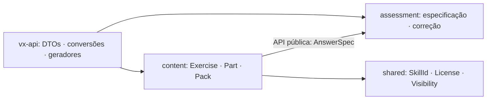

# ADR 0016 — Fronteiras e contrato mínimo de conteúdo na F1

- **Status:** aceito (contrato da F1.1 implementado e revisado; correção F1.2 e evidência F1.4 fora deste aceite)
- **Data:** 2026-10-15

## Contexto

A F1.1 exige resolver a propriedade de `Part` e `AnswerSpec` antes de publicar os contratos.
O ADR 0009 e a visão geral atribuem a especificação de correção ao `assessment`, mas o diagrama
do ADR 0014 agrupa `Part/AnswerSpec` no `content`. Além disso, `values[]` e `rows[][]` não
definem o tipo dos elementos, e o manifesto ilustrativo omite a identidade de `Pack` prevista
no modelo de dados.

Precisamos de uma única regra de correção, contratos gerados sem dependências de serialização
nas camadas internas e um recorte que não antecipe a Biblioteca da F2. Este ADR refina os
ADRs 0007, 0008, 0009, 0014 e 0015 nesses pontos; não os substitui integralmente nem altera
suas decisões de produto. Os registros históricos permanecem intactos.

## Decisão

`content` é dono de `Part` e consome `AnswerSpec` pela API pública Rust do `assessment`.
Os DTOs canônicos, JSON Schema e tipos TypeScript são definidos e gerados em `vx-api`,
separadamente dos tipos puros de domínio.

### 1. Propriedade e dependências

| Dono | API pública de domínio | Responsabilidade |
| ---- | ---------------------- | ---------------- |
| `assessment` | `AnswerSpec`, `ScalarAnswerSpec` e os tipos de tolerância, domínio de amostragem, forma e feedback usados por eles | Especificar e validar respostas; corrigir na F1.2 |
| `content` | `Exercise`, `Part`, `ExerciseList`, `Pack`, `Reference` e seus tipos de metadados | Estrutura editorial, identidade, referências, licença e visibilidade |
| `shared` | `SkillId`, `License`, `Visibility` na F1.1 | Valores compartilhados mínimos, conforme ADR 0014 |

- `Part.answer` tem o tipo público `assessment::AnswerSpec`. `content` não define uma cópia
  concorrente nem importa módulos internos do corretor. Os módulos de implementação ficam
  privados e os tipos necessários são reexportados na raiz pública do contexto.
- Na F1.2, os casos de uso de conteúdo consomem a API pública de aplicação do corretor
  (`CheckAnswer` e seus contratos puros). Não chamam `vx-api::dispatch` nem conhecem o parser
  concreto. O `assessment` não depende de `content` e recebe a especificação e os dados de
  correção, não um `Exercise` ou uma `Part` completos.
- “API pública” entre contextos significa a fachada Rust da camada correspondente, não o
  transporte JSON. Na F1.4, executar comandos de verificação continua atrás do port
  `EngineCommandRunner` do ADR 0015, implementado na camada externa.
- A reutilização futura de `Part` pela `library` permanece válida: `Part` continua no `content`.
  Isso não autoriza implementar `library` na F1.



### 2. Coleções de respostas

Na F1, `ScalarAnswerSpec` é a união **não recursiva** das variantes `numeric` e `expression`,
com os mesmos campos dessas variantes de `AnswerSpec`. Cada elemento carrega sua própria
tolerância e, quando for expressão, suas variáveis e restrições de domínio. Não se infere
`numeric` ou `expression` a partir de uma string.

- `set.values` e `tuple.values` são listas de `ScalarAnswerSpec`.
- `matrix.rows` é uma lista de linhas de `ScalarAnswerSpec`.
- Strings soltas, coleções aninhadas, equações e respostas objetivas como elementos são
  rejeitadas, com erro no caminho do elemento. Não há união `string | ScalarAnswerSpec`.
- `set.ordered` é obrigatoriamente `false`; a correção faz correspondência um a um, sem
  reutilizar um elemento da resposta. O conjunto vazio é representável.
- `tuple` é ordenada e não vazia. `matrix` tem pelo menos uma linha e uma coluna, com linhas
  de mesmo tamanho. Essas invariantes pertencem ao `assessment`.

Exemplos canônicos:

```json
{
  "type": "tuple",
  "values": [
    { "type": "numeric", "value": "1/2" },
    { "type": "expression", "expected": "x^2", "variables": ["x"] }
  ]
}
```

```json
{
  "type": "matrix",
  "rows": [[{ "type": "numeric", "value": "1" }, { "type": "numeric", "value": "0" }]]
}
```

### 3. Identidade e manifesto de pack

`Pack.id` é um UUIDv7 obrigatório, independente do nome e do caminho do ZIP. Reexportar o
mesmo pack preserva o `id`; renomeá-lo não cria outra identidade. `name` é metadado de exibição,
não parte da chave. O manifesto é a representação canônica dos metadados do pack, não outro
objeto com identidade própria.

A representação hifenizada de UUID aceita letras hexadecimais maiúsculas ou minúsculas,
mas essa diferença não cria outra identidade. Comparações de UUID para unicidade e resolução
de referências ignoram caixa ASCII; o documento pode preservar a grafia recebida. Isso não
torna rótulos de partes, números editoriais ou outros identificadores case-insensitive.

`manifest.json` contém `schemaVersion: 1`, `id`, `name`, `license`, `visibility` e `lists`
obrigatórios; `description` é opcional. `lists` é uma lista ordenada de UUIDv7 de
`ExerciseList`, sem duplicatas; não contém caminhos nem listas embutidas. Pode ser vazia em
pack que só contenha exercícios avulsos. Exercícios e listas são documentos nos diretórios
`exercises/` e `lists/`; seus IDs vêm dos documentos, nunca dos nomes dos arquivos.

Na validação do pack, cada ID do manifesto deve resolver para uma lista incluída, e cada
item de lista deve resolver para um exercício incluído e para partes existentes. A validação
cruzada pertence ao `content`; ler ZIP e verificar caminhos pertence aos adapters da F1.5.
Os limites de importação do formato continuam obrigatórios.

A licença e a visibilidade do manifesto não substituem as dos documentos. Publicar um pack
exige que o manifesto e todos os documentos incluídos possam ser públicos segundo suas
próprias regras; um manifesto público não promove conteúdo privado ou `proprietary`.

### 4. Camada dos contratos e recorte por unidade

- `serde`, `schemars` e `ts-rs` ficam **somente em `vx-api`** para este contrato, nunca em
  `vx-domain`, `vx-application` ou `vx-infra`. DTOs de `content` reutilizam o DTO público de
  `AnswerSpec` de `assessment`; não duplicam suas variantes. Conversões explícitas conectam
  DTOs e domínio, preservando erros por campo.
- JSON Schema e TypeScript são gerados dos mesmos DTOs Rust. O esquema de coleções deve
  expressar o discriminante `type` e o tipo dos elementos, sem `any` como substituto. Testes
  de conversão e contrato evitam divergência com os tipos puros. Os comandos reais de geração
  serão documentados pela implementação da F1.1; este ADR não inventa uma CLI já disponível.
- **F1.1:** tipos estruturais de exercício, partes, listas, pack, referências e as nove variantes
  de resposta da F1 (`numeric`, `expression`, `equation`, `set`, `tuple`, `matrix`, `choice`,
  `matching`, `self_graded`); validação estrutural e de publicação. Definir tipos não entrega
  os algoritmos nem o comando `assessment.check`, que pertencem à F1.2.
- `Reference.locator` continua texto opcional na F1, como no §11 do formato. `material` fica
  ausente ou `null`; um vínculo não nulo exige F2. Não se cria o `Locator` estruturado nem
  `EntityRef` de `shared` sem consumidor. `params` de exercício permanece ausente ou `null`.
- **F1.4:** `ContentHash`, `VerifySpec`, `Evidence`, `EvidenceMethod`, `EvidenceScope`,
  `VerifyExpectedAnswers`, `EngineCommandRunner`, hash canônico e lock. A F1.1 não cria
  placeholders JSON opacos para `verify`/`evidence`, não gera selos e não aceita evidência
  fornecida como confiável. Até F1.4, campos de verificação não suportados são rejeitados
  explicitamente; não são ignorados nem preservados como dados validados.
- `code`, `sql`, `Material`, `ReadingGuide`, coleções da Biblioteca, destaques, FSRS e demais
  tipos exclusivos da F2 ficam fora. Os campos opcionais da F1.4 serão incorporados de forma
  aditiva conforme o ADR 0015; este recorte não exige nova `schemaVersion`.

### 5. Esclarecimentos da revisão dos tipos da F1.1

- `Exercise.difficulty` e `estimated_minutes` são opcionais (`Option<u8>` e `Option<u32>`).
  No JSON, `difficulty` e `estimatedMinutes` podem estar ausentes ou ser `null`; quando
  informados, exigem inteiro de 1 a 5 e inteiro positivo, respectivamente. Ausência significa
  metadado não informado, sem estimativa ou dificuldade padrão inferida. Os exemplos do
  formato não tornavam esses campos obrigatórios.
- `ExpressionForm::NoNegativeExponents`, serializado como `no_negative_exponents`, é a
  concretização da forma “sem expoente negativo” já prevista no ADR 0009. A F1.1 apenas
  transporta essa exigência; a checagem estrutural pertence à F1.2. `samples`, quando
  informado em expressão ou equação, é inteiro de pelo menos 12; sua ausência mantém o
  padrão de 12 da especificação, sem executar amostragem na F1.1.
- `Matching.partial_credit` (`partialCredit` no JSON) pode permanecer como metadado booleano
  de autoria, com padrão `false` quando omitido. Não define fórmula, pesos, limiares,
  arredondamento ou veredito parcial, nem autoriza implementar pontuação. O uso efetivo da
  preferência depende da decisão de produto pendente no PRD. Validade estrutural de
  `partialCredit: true` na F1.1 não comprova que esse comportamento esteja disponível.
- `shared::JsonValue` é suporte técnico puro para os consumidores já existentes
  `solution.engine.request` e `viz.params`, sem `serde_json` no domínio. A árvore contém
  nulos, booleanos, strings, inteiros `Integer(i64)` e `Unsigned(u64)`, números `Number(f64)`
  finitos, listas e mapas ordenados. A conversão de JSON preserva inteiros representáveis em
  `i64`/`u64` antes de considerar `f64`; a exportação não os transforma em ponto flutuante.
  Isso preserva campos inteiros exigidos pelos comandos, como `sampleCount`, e evita perda
  de valor no round-trip Rust, inclusive para `u64::MAX`. Não implica precisão inteira
  arbitrária nem elimina os limites de `number` no JavaScript/TypeScript. Essa exceção
  técnica não transforma `shared` em repositório de entidades nem autoriza usar JSON opaco
  para respostas, evidência ou tipos futuros. Seu papel atual é transportar parâmetros,
  não definir hash canônico nem garantir precisão inteira arbitrária. O comando valida seu
  próprio request na execução; o registro de visualizações valida parâmetros na F1.6.
- `License` preserva identificadores não vazios desconhecidos como `Other`, sem presumir
  compatibilidade. A lista positiva inicial é `CC-BY-SA-4.0`, `CC-BY-4.0` e `CC0-1.0`;
  autoria pública no banco continua exigindo `CC-BY-SA-4.0`. Outras licenças ficam privadas
  até revisão explícita de compatibilidade, mesmo que possam ser abertas. Referências são
  apenas links/metadados: aceitam licenças restritivas e não relicenciam o exercício.
  A validação não é um catálogo SPDX completo nem uma conclusão jurídica automática.
- URLs de referências usam um subconjunto HTTP(S) conservador: autoridade obrigatória,
  host ASCII (incluindo punycode) ou IP válido, porta opcional numérica de 0 a 65535, sem
  credenciais, espaços literais, barras invertidas ou controles. Escapes percentuais devem
  estar completos e não codificar controles ASCII. Hosts Unicode devem ser fornecidos em
  punycode; não há promessa de aceitar toda URL válida segundo os padrões de navegador.
  HTTP e hosts locais continuam permitidos. Isso não é uma política de SSRF: a F1.1 não
  acessa rede nem consulta DNS, e validar o link não autoriza baixá-lo.
- Na F1.1, `SkillId` valida apenas a forma do identificador. Existência de habilidades no
  catálogo e demais validações do build de conteúdo pertencem à F1.3. Isso não adia a
  consistência interna de um `Pack` já carregado: IDs de listas, exercícios e partes
  continuam sendo resolvidos nos próprios documentos incluídos.
- JSON Schema e TypeScript descrevem a estrutura de transporte; validações semânticas e
  cruzadas continuam no domínio. Aprovação apenas pelo schema não significa conteúdo
  validado, publicável, corrigível ou verificado. Restrições estruturais simples, como
  `set.ordered = false` e linhas de matriz não vazias, devem também ser expressas no schema.
  Tipos gerados precisam ser regenerados após alterações nos DTOs antes do aceite da F1.1.

## Alternativas consideradas

- **`AnswerSpec` no `content`.** Aproxima o tipo da autoria, mas obriga o corretor a depender
  de conteúdo ou a manter outra especificação. Contraria a direção exigida pela F1.1.
- **`Part` e `AnswerSpec` em `shared`.** Facilita imports, mas move conceitos com regras
  editoriais e matemáticas para um núcleo que deveria conter apenas valores pequenos.
- **Coleções de strings.** São mais curtas, mas exigem política implícita ou campos externos
  para distinguir constantes de expressões e definir restrições por elemento.
- **`AnswerSpec` recursivo irrestrito.** Permite coleções arbitrárias, mas amplia schema,
  interface e algoritmos sem consumidor na F1.
- **Derivar contratos no domínio.** Evita DTOs e conversões, mas viola a fronteira dos
  ADRs 0002 e 0008. Implementar todos os tipos futuros agora também amplia a API sem aceite.

## Consequências

- A dependência é unidirecional: conteúdo usa o contrato público do corretor, nunca o inverso.
  A atribuição conjunta `Part/AnswerSpec` no diagrama histórico do ADR 0014 deve ser lida com
  este refinamento de propriedade.
- O contrato de coleção é maior, mas preserva as regras de cada elemento e não depende de
  inferência silenciosa. Os exemplos anteriores que mostravam apenas `values[]` passam a
  ter esta interpretação explícita, antes da primeira publicação do contrato.
- Há conversões entre DTOs e domínio a testar. A F1.1 deve comprovar imports públicos entre
  contextos, ausência das dependências proibidas e geração reproduzível, sem declarar F1.2
  ou F1.4 concluídas.
- A canonicalização, a tolerância registrada e os campos variáveis do lock continuam pendentes
  de revisão específica na F1.4, como exige o guia. Este ADR não decide esses detalhes.
