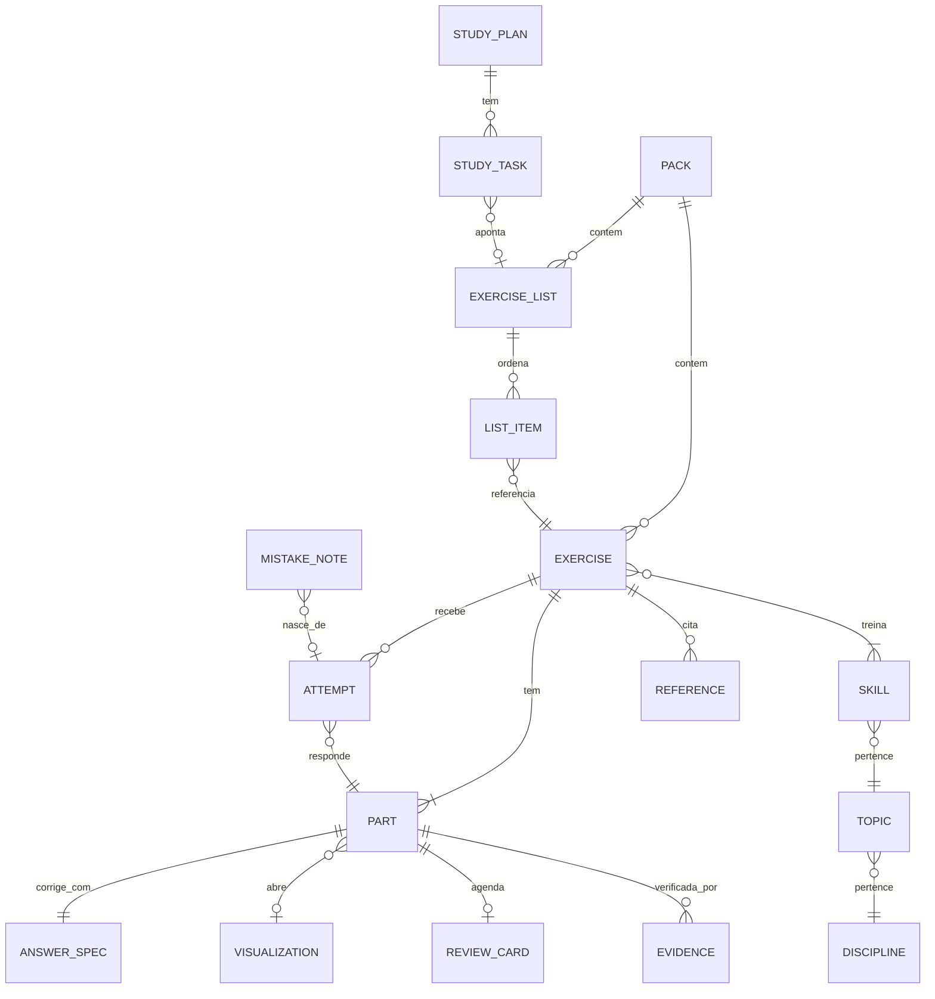
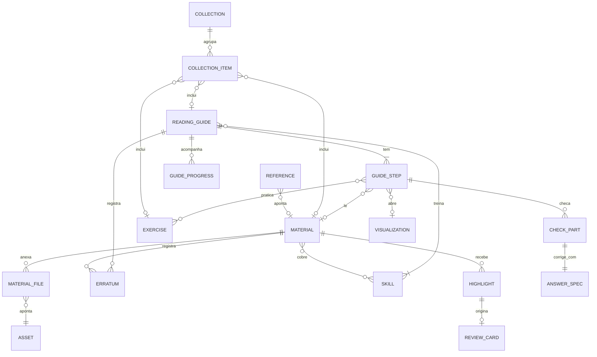

# Modelo de dados

Entidades dos contextos `content`, `assessment`, `review`, `progress` e `library`. O formato JSON
de cada uma está em [formato-de-exercicios.md](../02-produto/formato-de-exercicios.md); aqui ficam
as relações, onde cada dado mora em cada fase e as regras de identidade. A Biblioteca e a
generalização do `ReviewCard` vêm do [ADR 0014](adr/0014-biblioteca.md). A evidência de
verificação vem do [ADR 0015](adr/0015-evidencia-de-verificacao.md).

O recorte de implementação da F1.1 está no [ADR 0016](adr/0016-contrato-de-conteudo-f1.md):
`content` possui `Part`, que usa o `AnswerSpec` público de `assessment`. As coleções contêm
subespecificações escalares `numeric`/`expression`, não strings. Evidência e `ContentHash`
entram na F1.4; as entidades da Biblioteca abaixo continuam previstas apenas para F2.

## Entidades e relações

### Exercícios, revisão e progresso



### Biblioteca (F2; `references[]` já na F1)



`CHECK_PART` é o mesmo tipo `Part` do exercício, embutido na etapa. `REVIEW_CARD` tem alvo
polimórfico: parte de exercício **ou** nota com origem opcional num destaque.

| Entidade | Identidade | Observações |
| -------- | ---------- | ----------- |
| `Exercise` | UUIDv7 + `revision` | Imutável por revisão; editar cria `revision + 1` |
| `Part` | `exerciseId` + `label` | `label` estável ("a", "b"); nunca renumerar partes publicadas |
| `ExerciseList` | UUIDv7 | Ordem e numeração ("6a") nos itens, não no exercício |
| `Pack` | UUIDv7 (`id`) | `name` é metadado, não chave; `manifest.json` guarda `schemaVersion`, `id`, `name`, `description?`, `license`, `visibility` e `lists` (IDs ordenados de listas incluídas), conforme ADR 0016 |
| `Skill`/`Topic`/`Discipline` | caminho `area.disciplina.topico.habilidade` | Vêm de `content/taxonomy/*.yaml` ([taxonomia](../02-produto/taxonomia.md)) |
| `Visualization` | `id@versão` (ex.: `calculus.derivative@1`) | Registro em código; não é dado do usuário |
| `Attempt` | UUIDv7 | `exerciseId`, `revision`, `partLabel`, `response` (texto bruto), `verdict`, `feedbackId?`, `hintsUsed`, `durationMs`, `createdAt` |
| `ReviewCard` | UUIDv7; único por `exerciseId + partLabel` quando o alvo é `exercise_part` | Alvo polimórfico ([ADR 0014](adr/0014-biblioteca.md) §5): `exercise_part { exerciseId, partLabel }` ou `note { front, back, origin? }`, sendo `note` uma cópia que sobrevive ao destaque. Estado FSRS (`due`, `stability`, `difficulty`, `reps`, `lapses`, `state`). Visibilidade herdada da origem |
| `MistakeNote` | UUIDv7 | Caderno de erros: "erro" / "forma correta", opcionalmente ligado a uma tentativa |
| `StudyPlan`/`StudyTask` | UUIDv7 | Plano com data de prova; tarefas por dia com checklist |
| `Reference` | `exerciseId` + posição | Só metadados e link (F1); `material?` liga a um `Material` na F2 |
| `Evidence` | `exerciseId@revision#parte` + `method` | Gerada pelo compilador; `contentHash` + `engineVersion`; base do selo "verificado pelo motor" ([ADR 0015](adr/0015-evidencia-de-verificacao.md)) |
| `Material` | UUIDv7 + `revision` | `kind`, `origin`, `hosting`, `rights` (licença **por edição**, `checkedAt`, `aiUse`), `visibility`, citação CSL-JSON. Imutável por revisão. Status e selos são **derivados** |
| `Erratum` | `materialId` (ou `guideId`) + sequência | Só acréscimos: `correction` (gera revisão) ou `retraction` (`reason`, `replacedBy?`) |
| `Asset` | `sha256` dos bytes (por dono na F3) | `mime` detectado pelo conteúdo, tamanho, páginas; chave de armazenamento local ou R2 (UUID, nunca o nome do arquivo) |
| `MaterialFile` | `materialId + revision + assetHash` | Liga a revisão do material ao arquivo |
| `Collection` | UUIDv7 | `kind` (`family` ou `editions`); itens ordenados com `role` |
| `Highlight` | UUIDv7 | `materialId + revision`, `assetHash`, seletores W3C (citação + posição + página, ou `t=início,fim`), cor, nota. Âncora autossuficiente: funciona sem o arquivo no servidor |
| `ReadingGuide` | UUIDv7 + `revision` | Etapas com `id` estável: `read`, `questions`, `checks` (tipo `Part`), `exercises`, `viz` |
| `GuideProgress` | `guideId + stepId` | Etapas concluídas e respostas às checagens; não conta como domínio |

**Veredito** (`verdict`): `correct` · `incorrect` · `partially_correct` · `invalid_input` (não
conta como tentativa) · `self_reported_correct|incorrect|partial` (autoavaliação).

## Onde cada dado mora

| Dado | F0–F2 (sem conta) | F3 (com conta) |
| ---- | ----------------- | -------------- |
| Banco público (`content/`) | Arquivos no repo → JSON estático no build | Igual; espelhado no Postgres para busca e estatísticas |
| Exercícios e listas do usuário | IndexedDB (web) / SQLite (desktop) | Postgres (dono = usuário) + cópia local |
| Packs privados (terceiros) | Só local; `visibility = private` | Só local por padrão; upload exige opt-in explícito e fica privado |
| Tentativas, revisão, erros, planos | Local | Local + sync |
| Assets (imagens) | Blobs locais | R2 (privado, URLs assinadas) |
| Embeddings (busca semântica, F2+) | `sqlite-vec` / em memória | `pgvector` |
| Catálogo público da Biblioteca (`content/library/`) | Arquivos no repo → JSON estático no build | Igual; espelhado no Postgres |
| Evidência do banco público | `content/evidence.lock.json` (versionado) | Igual |
| Materiais, coleções e roteiros do usuário (metadados) | IndexedDB / SQLite (F2) | Postgres + cópia local, com sync |
| Arquivos **autorais** do usuário (PDF, imagens de notas) | Blob local (IndexedDB na web, pasta de dados do app no desktop) | Opt-in por item: R2 **privado**, varredura ClamAV, URLs pré-assinadas, cota por usuário |
| Arquivos de **terceiros** do usuário | Blob local | **Só local, sempre.** Em outro dispositivo, re-associado pelo hash quando o usuário adiciona o arquivo |
| Destaques, anotações, cartões `note`, progresso de roteiros | Local | Local + sync, sempre privados (inclusive o trecho citado de material de terceiros) |
| Texto extraído e índice da Biblioteca | MiniSearch local; índices público e privado separados | Postgres FTS + `pgvector` só para o que foi sincronizado |

Ports (na camada de aplicação do front e, depois, no núcleo):
`ExerciseRepository`, `ListRepository`, `AttemptRepository`, `ReviewRepository`,
`StudyPlanRepository`, `AssetStore`, `ContentIndex`. Biblioteca (F2): `MaterialRepository`,
`CollectionRepository`, `HighlightRepository`, `ReadingGuideRepository`, `LibraryIndex`,
`DocumentReader` (PDF.js) e `MetadataLookup` (DOI/arXiv, só sob ação do usuário). O `AssetStore`
passa a ser endereçado pelo hash do conteúdo. Adapters: `IndexedDb*` (Dexie), `TauriSqlite*`,
`Http*` (F3). Ver [ADR 0010](adr/0010-local-first-na-fase-1.md) e [ADR 0014](adr/0014-biblioteca.md).

## Esboço do schema relacional (SQLite agora, Postgres na F3)

O mesmo desenho serve para os dois: tipos portáveis, JSON para o que é documento.

```sql
CREATE TABLE exercise (
  id            TEXT    NOT NULL,          -- UUIDv7
  revision      INTEGER NOT NULL,
  pack_id       TEXT,
  visibility    TEXT    NOT NULL CHECK (visibility IN ('public', 'private')),
  license       TEXT    NOT NULL,          -- SPDX ou 'proprietary'
  body          TEXT    NOT NULL,          -- JSON canônico (Postgres: JSONB)
  created_at    TEXT    NOT NULL,
  PRIMARY KEY (id, revision)
);

CREATE TABLE exercise_skill (
  exercise_id   TEXT NOT NULL,
  skill         TEXT NOT NULL,             -- 'exatas.calculo.derivadas.regra-da-cadeia'
  PRIMARY KEY (exercise_id, skill)
);

CREATE TABLE attempt (
  id            TEXT    PRIMARY KEY,
  exercise_id   TEXT    NOT NULL,
  revision      INTEGER NOT NULL,
  part_label    TEXT    NOT NULL,
  response      TEXT    NOT NULL,
  verdict       TEXT    NOT NULL,
  feedback_id   TEXT,
  hints_used    INTEGER NOT NULL DEFAULT 0,
  duration_ms   INTEGER,
  created_at    TEXT    NOT NULL,
  FOREIGN KEY (exercise_id, revision) REFERENCES exercise (id, revision)
);

-- Alvo polimórfico (ADR 0014 §5). Substitui o esboço anterior, que tinha
-- PRIMARY KEY (exercise_id, part_label). O contexto review ainda não existe,
-- então não há migração de dados.
CREATE TABLE review_card (
  id            TEXT PRIMARY KEY,          -- UUIDv7
  target_kind   TEXT NOT NULL CHECK (target_kind IN ('exercise_part', 'note')),
  exercise_id   TEXT,                      -- exercise_part
  part_label    TEXT,                      -- exercise_part
  front         TEXT,                      -- note: Markdown sanitizado (cópia)
  back          TEXT,                      -- note
  origin_ref    TEXT,                      -- note: 'highlight:<uuid>' (EntityRef), opcional
  visibility    TEXT NOT NULL CHECK (visibility IN ('public', 'private')),
  fsrs_state    TEXT NOT NULL,             -- JSON do estado FSRS
  due_at        TEXT NOT NULL,
  CHECK (
    (target_kind = 'exercise_part' AND exercise_id IS NOT NULL AND part_label IS NOT NULL)
    OR (target_kind = 'note' AND front IS NOT NULL AND back IS NOT NULL)
  )
);
CREATE UNIQUE INDEX review_card_exercise_part ON review_card (exercise_id, part_label)
  WHERE target_kind = 'exercise_part';
CREATE UNIQUE INDEX review_card_origin ON review_card (origin_ref)
  WHERE origin_ref IS NOT NULL;           -- F2: no máximo um cartão por destaque
CREATE INDEX review_card_due ON review_card (due_at);

-- Biblioteca (F2)
CREATE TABLE material (
  id            TEXT    NOT NULL,          -- UUIDv7
  revision      INTEGER NOT NULL,
  kind          TEXT    NOT NULL CHECK (kind IN ('paper', 'book', 'notes', 'document', 'video', 'webpage')),
  origin        TEXT    NOT NULL CHECK (origin IN ('authored', 'open', 'third_party')),
  hosting       TEXT    NOT NULL CHECK (hosting IN ('link', 'inline', 'file')),
  visibility    TEXT    NOT NULL CHECK (visibility IN ('public', 'private')),
  license       TEXT    NOT NULL,          -- SPDX da edição, 'proprietary' ou 'unknown'
  ai_use        TEXT    NOT NULL DEFAULT 'unknown' CHECK (ai_use IN ('allowed', 'forbidden', 'unknown')),
  body          TEXT    NOT NULL,          -- JSON canônico (CSL-JSON, rights, sections, review…)
  created_at    TEXT    NOT NULL,
  PRIMARY KEY (id, revision)
);

CREATE TABLE material_skill (
  material_id   TEXT NOT NULL,
  skill         TEXT NOT NULL,
  locator       TEXT NOT NULL DEFAULT '',  -- '' = item inteiro; senão JSON do Locator
  PRIMARY KEY (material_id, skill, locator)
);

CREATE TABLE erratum (                     -- só INSERT; status é derivado daqui
  subject_ref   TEXT    NOT NULL,          -- 'material:<uuid>' | 'guide:<uuid>'
  seq           INTEGER NOT NULL,
  kind          TEXT    NOT NULL CHECK (kind IN ('correction', 'retraction')),
  revision      INTEGER,                   -- revisão criada pela correção
  reason        TEXT CHECK (reason IN ('error', 'copyright', 'author_request', 'other')),
  replaced_by   TEXT,
  note          TEXT    NOT NULL,
  created_at    TEXT    NOT NULL,
  PRIMARY KEY (subject_ref, seq)
);

CREATE TABLE asset (
  hash          TEXT    PRIMARY KEY,       -- 'sha256:<hex>' dos bytes; F3: PK (owner_id, hash)
  mime          TEXT    NOT NULL,          -- detectado pelo conteúdo
  size_bytes    INTEGER NOT NULL,
  page_count    INTEGER,
  storage_key   TEXT    NOT NULL,          -- chave local; F3: chave R2 aleatória (UUID)
  scan_status   TEXT    NOT NULL DEFAULT 'not_scanned'
                CHECK (scan_status IN ('not_scanned', 'pending', 'clean', 'infected', 'failed')),
  created_at    TEXT    NOT NULL
);

CREATE TABLE material_file (
  material_id   TEXT    NOT NULL,
  revision      INTEGER NOT NULL,
  asset_hash    TEXT    NOT NULL REFERENCES asset (hash),
  PRIMARY KEY (material_id, revision, asset_hash),
  FOREIGN KEY (material_id, revision) REFERENCES material (id, revision)
);

CREATE TABLE collection (
  id            TEXT PRIMARY KEY,
  kind          TEXT NOT NULL CHECK (kind IN ('family', 'editions')),
  visibility    TEXT NOT NULL CHECK (visibility IN ('public', 'private')),
  body          TEXT NOT NULL              -- título, descrição
);

CREATE TABLE collection_item (
  collection_id TEXT    NOT NULL REFERENCES collection (id),
  position      INTEGER NOT NULL,
  item_ref      TEXT    NOT NULL,          -- 'material:<uuid>' | 'guide:<uuid>' | 'exercise:<uuid>' | 'list:<uuid>'
  role          TEXT    NOT NULL CHECK (role IN ('main', 'companion', 'prerequisite', 'alternative', 'edition')),
  PRIMARY KEY (collection_id, position)
);

CREATE TABLE highlight (
  id            TEXT    PRIMARY KEY,       -- UUIDv7
  material_id   TEXT    NOT NULL,
  revision      INTEGER NOT NULL,
  asset_hash    TEXT,                      -- arquivo em que foi feito; NULL para link/inline
  selector      TEXT    NOT NULL,          -- JSON: TextQuote + TextPosition + página, ou Fragment t=
  color         TEXT    NOT NULL,
  note          TEXT,                      -- Markdown, sanitizado na exibição
  anchor_state  TEXT    NOT NULL DEFAULT 'exact' CHECK (anchor_state IN ('exact', 'reanchored', 'orphan')),
  created_at    TEXT    NOT NULL,
  updated_at    TEXT    NOT NULL
);
CREATE INDEX highlight_material ON highlight (material_id);

CREATE TABLE reading_guide (
  id            TEXT    NOT NULL,
  revision      INTEGER NOT NULL,
  visibility    TEXT    NOT NULL CHECK (visibility IN ('public', 'private')),
  license       TEXT    NOT NULL,
  body          TEXT    NOT NULL,          -- JSON canônico com steps[]
  created_at    TEXT    NOT NULL,
  PRIMARY KEY (id, revision)
);

CREATE TABLE guide_skill (
  guide_id      TEXT NOT NULL,
  skill         TEXT NOT NULL,
  PRIMARY KEY (guide_id, skill)
);

CREATE TABLE guide_progress (
  guide_id      TEXT    NOT NULL,
  revision      INTEGER NOT NULL,
  step_id       TEXT    NOT NULL,
  completed_at  TEXT,
  checks        TEXT,                      -- JSON: rótulo → veredito da última resposta
  PRIMARY KEY (guide_id, step_id)
);
```

Na F3 todas as tabelas de usuário ganham `owner_id` e **Row-Level Security** no Postgres
(`owner_id = current_setting('app.user_id')`), como defesa em profundidade contra A01:2025
(Broken Access Control), além da checagem na aplicação.

## Regras de integridade
- Uma tentativa sempre aponta para a **revisão** que o estudante viu.
- Apagar um exercício do usuário apaga em cascata as tentativas e cartões dele, com confirmação e
  exportação oferecida antes.
- `visibility = private` não pode virar `public` se `license = proprietary` (regra de domínio no
  contexto `content`, testada).
- **Política de hospedagem** ([ADR 0014](adr/0014-biblioteca.md) §4, testada no domínio):
  - em `content/`, material não autoral só existe como `hosting = link`;
  - arquivo de terceiros nunca é enviado à nuvem nem compartilhado;
  - NC/ND/`proprietary`/`unknown` são sempre só link fora do dispositivo.
- Material público ou compartilhado tem pelo menos uma habilidade da taxonomia. Material privado
  pode ficar sem classificação.
- `erratum` só recebe acréscimos. O status (`active | corrected | retracted`) é derivado dele e
  nunca é gravado à mão.
- Retirada com `reason = copyright` apaga os assets e o corpo de todas as revisões. Fica só a
  lápide (título, motivo, data, substituto).
- Apagar um material do usuário apaga em cascata os destaques dele, com confirmação. Cartões `note`
  continuam, com "origem indisponível".
- Destaques e cartões herdam a visibilidade do material. O trecho citado de material de terceiros
  é privado e nunca entra em exportação pública ou grupo.
- Selos (`authored`, `open_source`, `reviewed`, `ai_generated`, `engine_verified`) são calculados
  por função de domínio. O de motor depende de evidência válida para o `contentHash` atual
  ([ADR 0015](adr/0015-evidencia-de-verificacao.md)).
- Na F3, `asset` deduplica por hash **só dentro do mesmo dono**. Deduplicar entre usuários
  revelaria quem tem qual arquivo.
