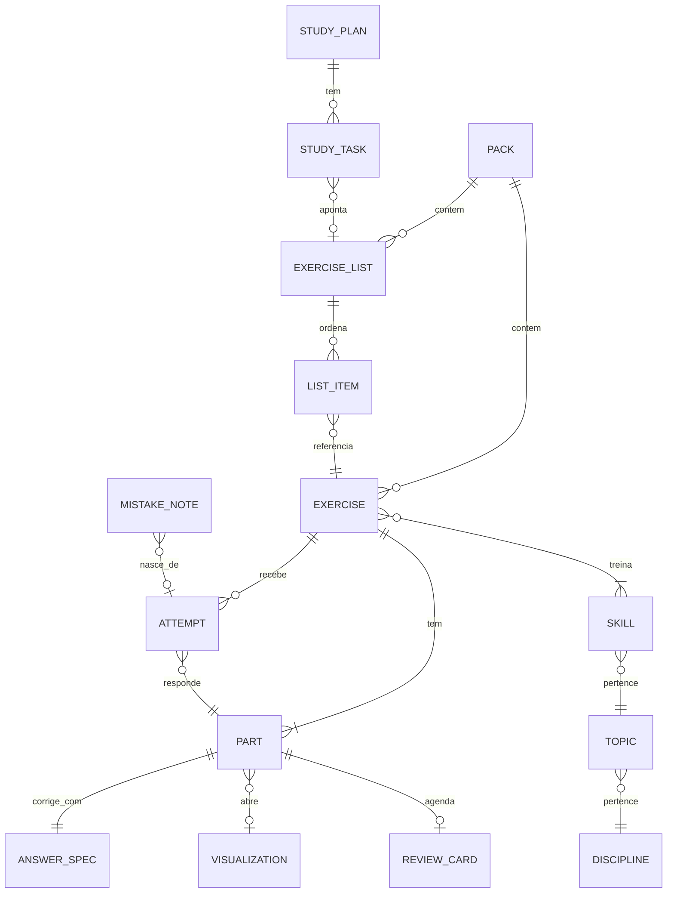

# Modelo de dados

Entidades dos contextos `content`, `assessment`, `review` e `progress`. O formato JSON de cada uma
está em [formato-de-exercicios.md](../02-produto/formato-de-exercicios.md); aqui ficam as relações,
onde cada dado mora em cada fase e as regras de identidade.

## Entidades e relações



| Entidade | Identidade | Observações |
| -------- | ---------- | ----------- |
| `Exercise` | UUIDv7 + `revision` | Imutável por revisão; editar cria `revision + 1` |
| `Part` | `exerciseId` + `label` | `label` estável ("a", "b"); nunca renumerar partes publicadas |
| `ExerciseList` | UUIDv7 | Ordem e numeração ("6a") nos itens, não no exercício |
| `Pack` | UUIDv7 + `name` | Unidade de importação/exportação; guarda `license` e `visibility` |
| `Skill`/`Topic`/`Discipline` | caminho `area.disciplina.topico.habilidade` | Vêm de `content/taxonomy/*.yaml` ([taxonomia](../02-produto/taxonomia.md)) |
| `Visualization` | `id@versão` (ex.: `calculus.derivative@1`) | Registro em código; não é dado do usuário |
| `Attempt` | UUIDv7 | `exerciseId`, `revision`, `partLabel`, `response` (texto bruto), `verdict`, `feedbackId?`, `hintsUsed`, `durationMs`, `createdAt` |
| `ReviewCard` | `exerciseId` + `partLabel` | Estado FSRS (`due`, `stability`, `difficulty`, `reps`, `lapses`, `state`) |
| `MistakeNote` | UUIDv7 | Caderno de erros: "erro" / "forma correta", opcionalmente ligado a uma tentativa |
| `StudyPlan`/`StudyTask` | UUIDv7 | Plano com data de prova; tarefas por dia com checklist |

**Veredito** (`verdict`): `correct` · `incorrect` · `partially_correct` · `invalid_input` (não
conta como tentativa) · `self_reported_correct|incorrect|partial` (autoavaliação).

## Onde cada dado mora

| Dado | F0–F2 (sem conta) | F3 (com conta) |
| ---- | ----------------- | -------------- |
| Banco público (`content/`) | Arquivos no repo → JSON estático no build | Igual; espelhado no Postgres para busca e estatísticas |
| Exercícios e listas do usuário | IndexedDB (web) / SQLite (desktop) | Postgres (dono = usuário) + cópia local |
| Packs privados (terceiros) | Só local; `visibility = private` | Só local por padrão; upload exige opt-in explícito e fica privado |
| Tentativas, revisão, erros, planos | Local | Local + sync |
| Assets (imagens) | Blobs locais | R2 (privado, URLs assinadas) |
| Embeddings (busca semântica, F2+) | `sqlite-vec` / em memória | `pgvector` |

Ports (na camada de aplicação do front e, depois, no núcleo):
`ExerciseRepository`, `ListRepository`, `AttemptRepository`, `ReviewRepository`,
`StudyPlanRepository`, `AssetStore`, `ContentIndex`. Adapters: `IndexedDb*` (Dexie),
`TauriSqlite*`, `Http*` (F3). Ver [ADR 0010](adr/0010-local-first-na-fase-1.md).

## Esboço do schema relacional (SQLite agora, Postgres na F3)

O mesmo desenho serve para os dois: tipos portáveis, JSON para o que é documento.

```sql
CREATE TABLE exercise (
  id            TEXT    NOT NULL,          -- UUIDv7
  revision      INTEGER NOT NULL,
  pack_id       TEXT,
  visibility    TEXT    NOT NULL CHECK (visibility IN ('public', 'private')),
  license       TEXT    NOT NULL,          -- SPDX ou 'proprietary'
  body          TEXT    NOT NULL,          -- JSON canônico (Postgres: JSONB)
  created_at    TEXT    NOT NULL,
  PRIMARY KEY (id, revision)
);

CREATE TABLE exercise_skill (
  exercise_id   TEXT NOT NULL,
  skill         TEXT NOT NULL,             -- 'exatas.calculo.derivadas.regra-da-cadeia'
  PRIMARY KEY (exercise_id, skill)
);

CREATE TABLE attempt (
  id            TEXT    PRIMARY KEY,
  exercise_id   TEXT    NOT NULL,
  revision      INTEGER NOT NULL,
  part_label    TEXT    NOT NULL,
  response      TEXT    NOT NULL,
  verdict       TEXT    NOT NULL,
  feedback_id   TEXT,
  hints_used    INTEGER NOT NULL DEFAULT 0,
  duration_ms   INTEGER,
  created_at    TEXT    NOT NULL,
  FOREIGN KEY (exercise_id, revision) REFERENCES exercise (id, revision)
);

CREATE TABLE review_card (
  exercise_id   TEXT NOT NULL,
  part_label    TEXT NOT NULL,
  fsrs_state    TEXT NOT NULL,             -- JSON do estado FSRS
  due_at        TEXT NOT NULL,
  PRIMARY KEY (exercise_id, part_label)
);
CREATE INDEX review_card_due ON review_card (due_at);
```

Na F3 todas as tabelas de usuário ganham `owner_id` e **Row-Level Security** no Postgres
(`owner_id = current_setting('app.user_id')`), como defesa em profundidade contra A01:2025
(Broken Access Control), além da checagem na aplicação.

## Regras de integridade
- Uma tentativa sempre aponta para a **revisão** que o estudante viu.
- Apagar um exercício do usuário apaga em cascata as tentativas e cartões dele, com confirmação e
  exportação oferecida antes.
- `visibility = private` não pode virar `public` se `license = proprietary` (regra de domínio no
  contexto `content`, testada).
