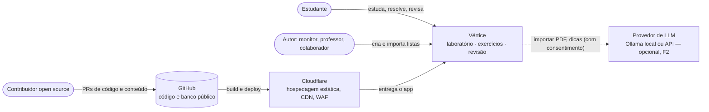
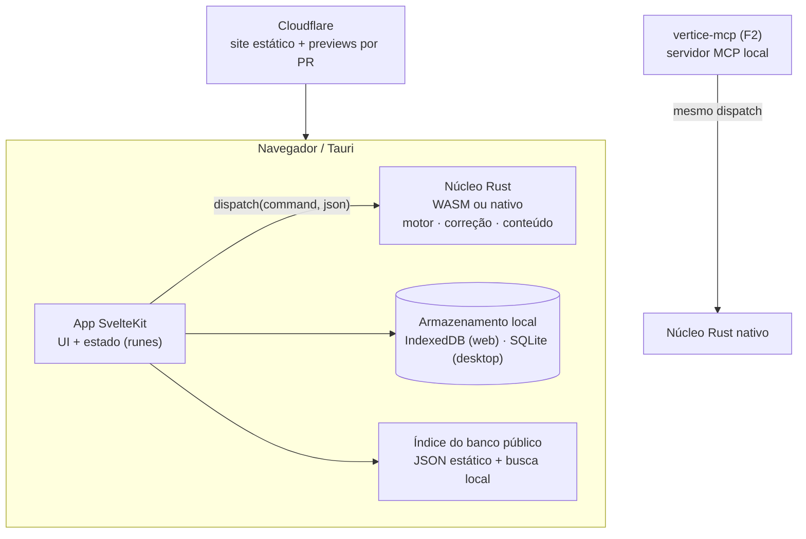
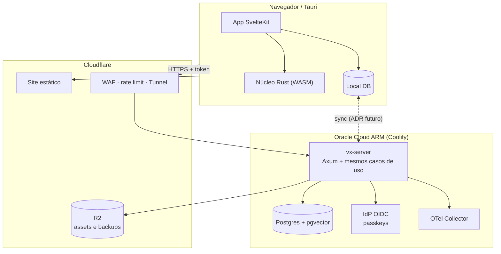
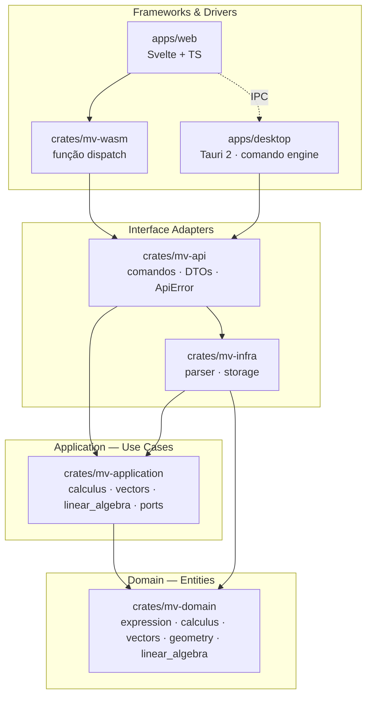

# Arquitetura — visão geral

A Vértice é um **monólito modular local-first**: um núcleo Rust (motor matemático + correção de
exercícios + regras de conteúdo) que roda **no navegador (WASM), no desktop (Tauri) e, na Fase 3,
no servidor (Axum)**, com uma interface SvelteKit. O código segue a **Clean Architecture**
(Robert C. Martin): camadas concêntricas em que **as dependências só apontam para dentro**.

Princípios:
1. **Mesmo núcleo em todo lugar.** Um exercício corrigido offline e no servidor dá o mesmo veredito.
2. **Local-first.** Sem conta, tudo funciona; a nuvem é um adapter a mais ([ADR 0010](adr/0010-local-first-na-fase-1.md)).
3. **Conteúdo como código.** O banco público é um diretório versionado; o privado nunca entra no git.
4. **Contextos como módulos** dentro das camadas, não microsserviços ([ADR 0007](adr/0007-contextos-como-modulos.md)).
5. **Contratos gerados.** Tipos Rust geram JSON Schema e tipos TS ([ADR 0008](adr/0008-formato-canonico-de-exercicio.md)).

## Sistema (C4 — nível 1: contexto)

## Containers (C4 — nível 2) por fase

### Fases 0–2: sem servidor próprio

### Fase 3: contas e nuvem ([ADR 0011](adr/0011-backend-axum-postgres.md))

Modelo de dados: [modelo-de-dados.md](modelo-de-dados.md). Segurança:
[modelo de ameaças](../06-seguranca/modelo-de-ameacas.md). Infra: [DevOps](../07-devops/ambientes-e-deploy.md).

## Contextos do núcleo

| Contexto | Responsabilidade | Status |
| -------- | ---------------- | ------ |
| `expression`, `calculus`, `vectors`, `geometry`, `linear_algebra` | Motor matemático do Laboratório | ✅ |
| `assessment` | `AnswerSpec`, correção, feedback de erro comum | 🔜 F1 |
| `content` | Exercício, lista, pack, taxonomia, validação, compilação de `*.ex.md` | 🔜 F1 |
| `review` | Estado FSRS dos cartões de revisão | 🔜 F2 |
| `progress` | Tentativas e domínio por habilidade | 🔜 F2 |

Os nomes de crates abaixo ainda são `mv-*`; o renome para `vx-*` é da Fase 0
([ADR 0006](adr/0006-plataforma-vertice.md)).

## Camadas

| Camada                | Onde                                  | Responsabilidade                                    |
| --------------------- | ------------------------------------- | --------------------------------------------------- |
| Domain (entities)     | `crates/mv-domain`                    | Conceitos e regras matemáticas puras                |
| Application           | `crates/mv-application`               | Casos de uso e *ports* (interfaces para o exterior) |
| Interface adapters    | `crates/mv-infra`, `crates/mv-api`    | Parser (implementa port) e contrato JSON do motor   |
| Frameworks & drivers  | `mv-wasm`, `apps/desktop`, `apps/web` | Entrega: navegador, desktop, interface              |

Detalhes e regras de importação: [camadas.md](camadas.md).

## Regra de dependência

- `mv-domain` depende só de `std` e de bibliotecas numéricas puras (`nalgebra`, [ADR 0004](adr/0004-bibliotecas-matematicas-no-dominio.md)).
- `mv-application` depende só de `mv-domain`. Define *traits* (ports) para tudo que precisa de fora.
- `mv-infra` implementa esses traits (inversão de dependência).
- `mv-api` monta os casos de uso com os adapters e define o contrato JSON ([ADR 0005](adr/0005-mv-api-dispatch-unico.md)).
- `mv-wasm` e `src-tauri` têm **uma função cada**, que só repassa para `mv_api::dispatch`.

A regra é verificável: basta olhar os `[dependencies]` de cada `Cargo.toml`.

## Fluxo de uma requisição: "limite de sin(x)/x em x → 0"

## Por que duas entregas (WASM e Tauri)?

O mesmo núcleo Rust roda:
- **no navegador**, compilado para WebAssembly (zero instalação, ideal para aula);
- **no desktop**, via Tauri (acesso a arquivos, instalador leve, performance nativa).

A UI não sabe qual está usando: ela só conhece os ports (`CalculusEngine`, `VectorEngine`,
`LinearAlgebraEngine`). O `composition/engines.ts` escolhe o transporte em runtime.
Ver [ADR 0003](adr/0003-wasm-e-desktop.md) e [ADR 0005](adr/0005-mv-api-dispatch-unico.md).

## Decisões registradas
- [ADR 0001 — Rust + Tauri + Svelte](adr/0001-rust-tauri-svelte.md)
- [ADR 0002 — Clean Architecture](adr/0002-clean-architecture.md)
- [ADR 0003 — WASM e desktop com o mesmo núcleo](adr/0003-wasm-e-desktop.md)
- [ADR 0004 — Bibliotecas matemáticas puras no domínio](adr/0004-bibliotecas-matematicas-no-dominio.md)
- [ADR 0005 — `mv-api`: contrato JSON único](adr/0005-mv-api-dispatch-unico.md)
- [ADR 0006 — Plataforma Vértice: nome e módulos](adr/0006-plataforma-vertice.md)
- [ADR 0007 — Contextos como módulos dentro das camadas](adr/0007-contextos-como-modulos.md)
- [ADR 0008 — Formato canônico de exercício](adr/0008-formato-canonico-de-exercicio.md)
- [ADR 0009 — Correção de respostas no motor Rust](adr/0009-correcao-no-motor-rust.md)
- [ADR 0010 — Local-first na Fase 1](adr/0010-local-first-na-fase-1.md)
- [ADR 0011 — Backend futuro: Axum + Postgres](adr/0011-backend-axum-postgres.md) (proposto)
- [ADR 0012 — Conteúdo de terceiros e licenças](adr/0012-conteudo-de-terceiros-e-licencas.md)
- [ADR 0013 — Direção de design: claro neutro, telas A/D](adr/0013-direcao-de-design.md)
