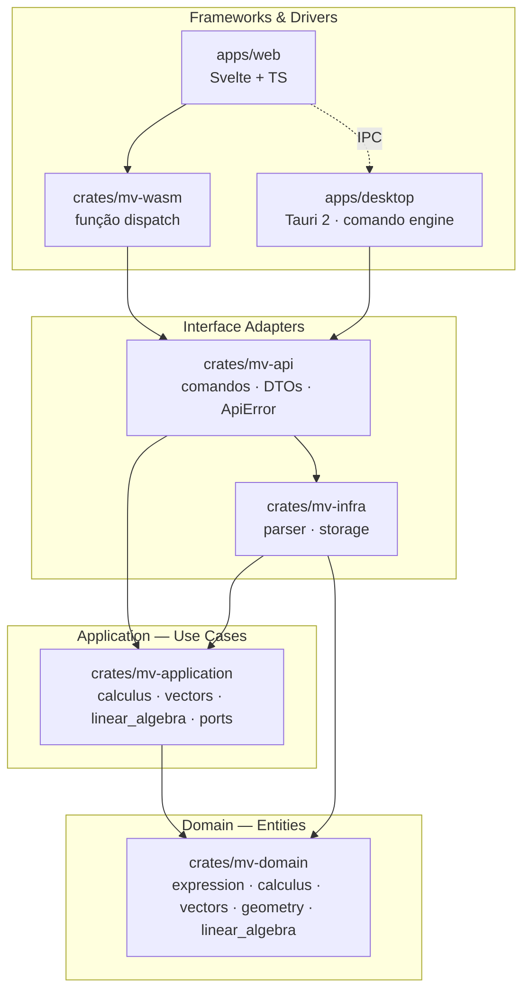

# Arquitetura — visão geral

O Math View segue a **Clean Architecture** (Robert C. Martin): o sistema é dividido em camadas
concêntricas e **as dependências de código só apontam para dentro**. As regras matemáticas (o que
mais importa) ficam no centro, isoladas de frameworks, UI e detalhes de entrega.

## Camadas

| Camada                | Onde                                  | Responsabilidade                                    |
| --------------------- | ------------------------------------- | --------------------------------------------------- |
| Domain (entities)     | `crates/mv-domain`                    | Conceitos e regras matemáticas puras                |
| Application           | `crates/mv-application`               | Casos de uso e *ports* (interfaces para o exterior) |
| Interface adapters    | `crates/mv-infra`, `crates/mv-api`    | Parser (implementa port) e contrato JSON do motor   |
| Frameworks & drivers  | `mv-wasm`, `apps/desktop`, `apps/web` | Entrega: navegador, desktop, interface              |

Detalhes e regras de importação: [camadas.md](camadas.md).

## Regra de dependência

- `mv-domain` depende só de `std` e de bibliotecas numéricas puras (`nalgebra`, [ADR 0004](adr/0004-bibliotecas-matematicas-no-dominio.md)).
- `mv-application` depende só de `mv-domain`. Define *traits* (ports) para tudo que precisa de fora.
- `mv-infra` implementa esses traits (inversão de dependência).
- `mv-api` monta os casos de uso com os adapters e define o contrato JSON ([ADR 0005](adr/0005-mv-api-dispatch-unico.md)).
- `mv-wasm` e `src-tauri` têm **uma função cada**, que só repassa para `mv_api::dispatch`.

A regra é verificável: basta olhar os `[dependencies]` de cada `Cargo.toml`.

## Fluxo de uma requisição: "limite de sin(x)/x em x → 0"

## Por que duas entregas (WASM e Tauri)?

O mesmo núcleo Rust roda:
- **no navegador**, compilado para WebAssembly (zero instalação, ideal para aula);
- **no desktop**, via Tauri (acesso a arquivos, instalador leve, performance nativa).

A UI não sabe qual está usando: ela só conhece os ports (`CalculusEngine`, `VectorEngine`,
`LinearAlgebraEngine`). O `composition/engines.ts` escolhe o transporte em runtime.
Ver [ADR 0003](adr/0003-wasm-e-desktop.md) e [ADR 0005](adr/0005-mv-api-dispatch-unico.md).

## Decisões registradas
- [ADR 0001 — Rust + Tauri + Svelte](adr/0001-rust-tauri-svelte.md)
- [ADR 0002 — Clean Architecture](adr/0002-clean-architecture.md)
- [ADR 0003 — WASM e desktop com o mesmo núcleo](adr/0003-wasm-e-desktop.md)
- [ADR 0004 — Bibliotecas matemáticas puras no domínio](adr/0004-bibliotecas-matematicas-no-dominio.md)
- [ADR 0005 — `mv-api`: contrato JSON único](adr/0005-mv-api-dispatch-unico.md)
