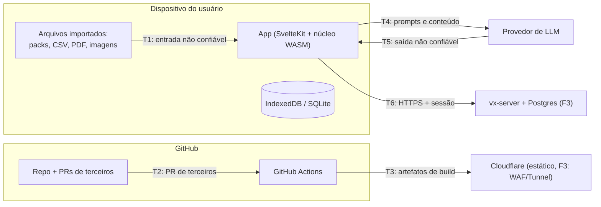

# Modelo de ameaças

Método: **STRIDE** por fronteira de confiança, revisado a cada fase do roadmap e a cada ADR que
mude uma fronteira. Responsável: agente `security-researcher` ([AGENTS.md](../../AGENTS.md#papéis)).
Mapeamento para OWASP: [owasp.md](owasp.md).

## Ativos

| Ativo | Por que importa |
| ----- | --------------- |
| Material privado de terceiros (packs `private`) | Direitos autorais; não pode vazar ([ADR 0012](../03-arquitetura/adr/0012-conteudo-de-terceiros-e-licencas.md)) |
| Dados de estudo do usuário (tentativas, erros, planos) | Privacidade (LGPD a partir da F3) |
| Chaves de API de LLM do usuário (BYOK, F2) | Custo financeiro e abuso |
| Integridade do banco público e dos releases | Cadeia de suprimentos: quem baixa o app ou o pack confia no conteúdo |
| Contas e sessões (F3) | Tomada de conta |
| Infra (Oracle, Cloudflare, GitHub) | Custos, defacement, pivô |

## Fronteiras de confiança

## Ameaças e mitigações

### T1 — Importação de packs, CSV, imagens e Markdown (F1)
| STRIDE | Ameaça | Mitigação |
| ------ | ------ | --------- |
| Tampering / DoS | Zip bomb, milhares de arquivos, imagens gigantes | Limites do [formato](../02-produto/formato-de-exercicios.md#8-pack-verticezip): 50 MB descompactado, 2.000 arquivos, razão 100:1, 5 MB por imagem; leitura em streaming no núcleo Rust |
| Tampering | *Zip slip* (`../../`), links simbólicos, nomes absolutos | Normalizar caminhos, rejeitar `..`, absolutos e symlinks; nunca gravar no FS com o nome vindo do zip |
| Elevation (XSS) | Enunciado com `<script>`, `javascript:` em links, SVG com script, CSS malicioso | Markdown sem HTML cru; **DOMPurify** no HTML final; SVG sanitizado ou convertido para imagem; KaTeX com `trust: false`, `maxSize`, `maxExpand`; **CSP** estrita sem `unsafe-inline` para scripts; Trusted Types |
| DoS | Expressão patológica (aninhamento profundo, `x^x^x^…`) travando o parser/avaliador | Limite de tamanho e profundidade no parser; amostragem com teto de tempo; tudo num Web Worker |
| Spoofing | Pack se passando por "oficial" | Packs públicos só via repositório; packs importados sempre exibem a origem e a licença |
| Info disclosure | Exportar pack público contendo item `private` | Regra de domínio + teste: `proprietary` nunca vira `public` |

### T2/T3 — Cadeia de suprimentos e CI (F0)
| Ameaça | Mitigação |
| ------ | --------- |
| Dependência maliciosa ou typosquatting (npm/crates) | Lockfiles versionados, `pnpm install --frozen-lockfile`, `cargo-deny` (licenças, fontes, advisories), `cargo-audit`, OSV-Scanner, Renovate com revisão humana |
| PR de terceiro roubando segredos via workflow | `pull_request` (não `pull_request_target`) para código externo; `permissions:` mínimas por job; nenhum segredo em jobs de PR; Actions fixadas por **SHA** |
| Segredo commitado | gitleaks na CI + pre-commit; `.env` no `.gitignore` (já está) |
| Artefato adulterado | Builds reprodutíveis na CI; SBOM (syft); assinatura com **cosign** keyless (Sigstore); proveniência SLSA via GitHub Attestations |
| Material de terceiros commitado por engano | Job que falha se aparecer PDF ou `content-private/` no diff |

### T4/T5 — LLM (F2)
Detalhes da arquitetura em [estratégia de IA](../08-ia/estrategia-ia.md).

| Ameaça (OWASP LLM 2025) | Mitigação |
| ----------------------- | --------- |
| LLM01 Prompt injection vinda do PDF importado ("ignore as instruções e…") | O PDF é **dado**: delimitado no prompt, sem ferramentas com efeito colateral no fluxo de importação, saída só como JSON validado |
| LLM05 Saída imprópria (HTML/JS no enunciado gerado) | Saída validada contra o JSON Schema e passada pelo mesmo sanitizador de T1 |
| LLM02 Vazamento de dados privados para o provedor | Conteúdo `private` só vai a provedor externo com confirmação por ação; Ollama local como padrão sugerido |
| LLM10 Consumo ilimitado (custo da chave BYOK) | Orçamento por sessão, limite de tokens por requisição, cache de respostas |
| LLM06 Agência excessiva (MCP) | `vertice-mcp` expõe só comandos de leitura/cálculo; nada de escrita em disco ou rede |
| Chave BYOK roubada via XSS | Chave guardada só no desktop (keychain do SO via Tauri) ou na memória da sessão web; nunca em `localStorage`; CSP de T1 |

### Execução de código dos exercícios (F2)
| Ameaça | Mitigação |
| ------ | --------- |
| Código do estudante ou do pack acessando rede, DOM ou dados do app | Execução em **Web Worker** dentro de iframe `sandbox` com origem opaca, CSP `connect-src 'none'`, tempo e memória limitados |
| Judge no servidor (F3) com escape de container | Isolamento forte (gVisor/Firecracker ou nsjail), sem rede, rootless, cotas; nunca no mesmo host do banco |

### T6 — Servidor e contas (F3) — ASVS 5.0 nível 2
| Ameaça | Mitigação |
| ------ | --------- |
| A01 Broken access control (IDOR em listas/tentativas) | Autorização em cada caso de uso + **RLS** no Postgres por `owner_id`; testes de autorização automatizados |
| A07 Falhas de autenticação | Passkeys/OIDC, sem senha própria; sessões curtas com rotação; cookies `HttpOnly; Secure; SameSite=Lax` |
| SSRF (agora parte de A01:2025) ao baixar assets por URL | Não buscar URLs arbitrárias; se necessário, allowlist + resolver DNS fora de faixas privadas |
| A09 Falta de logs e alertas | Logs estruturados (`tracing`) sem dados sensíveis, trilha de auditoria de ações administrativas, alertas no Grafana |
| DoS | Rate limit no Cloudflare e no Axum (`tower-governor`), limites de corpo de requisição |

### Desktop (Tauri)
- Capabilities mínimas (`apps/desktop/src-tauri/capabilities/default.json`): só o comando `engine`
  e, na F1, o de armazenamento; sem `shell`, sem FS amplo.
- CSP também no Tauri; atualizações assinadas pelo updater do Tauri.

## Processo
- Todo PR que toque uma fronteira acima marca o agente `security-researcher` para revisão.
- A cada fase: revisar esta tabela, rodar os scanners e registrar riscos aceitos.
- Vulnerabilidades: [SECURITY.md](../../SECURITY.md).
