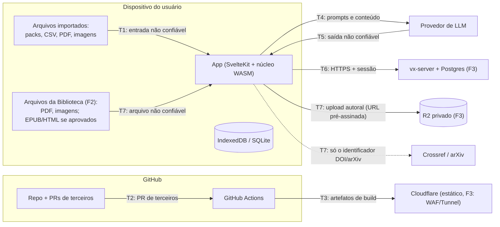

# Modelo de ameaças

Método: **STRIDE** por fronteira de confiança, revisado a cada fase do roadmap e a cada ADR que
mude uma fronteira. Responsável: agente `security-researcher` ([AGENTS.md](../../AGENTS.md#papéis)).
Mapeamento para OWASP: [owasp.md](owasp.md).

## Ativos

| Ativo | Por que importa |
| ----- | --------------- |
| Material privado de terceiros (packs `private`) | Direitos autorais; não pode vazar ([ADR 0012](../03-arquitetura/adr/0012-conteudo-de-terceiros-e-licencas.md)) |
| Dados de estudo do usuário (tentativas, erros, planos) | Privacidade (LGPD a partir da F3) |
| Chaves de API de LLM do usuário (BYOK, F2) | Custo financeiro e abuso |
| Integridade do banco público e dos releases | Cadeia de suprimentos: quem baixa o app ou o pack confia no conteúdo |
| Contas e sessões (F3) | Tomada de conta |
| Infra (Oracle, Cloudflare, GitHub) | Custos, defacement, pivô |
| Biblioteca do usuário: arquivos, destaques, anotações e o que ele lê (F2+) | Privacidade (o hábito de leitura é sensível) e direitos autorais (cópias privadas de terceiros nunca saem do dispositivo, [ADR 0014](../03-arquitetura/adr/0014-biblioteca.md)) |
| Integridade do catálogo: licença por edição, status, errata e selos (F2+) | Selo ou licença falsos levam a estudar material errado ou a redistribuir o que não se pode |
| Canal de denúncia e trilha de auditoria (F4) | Base legal e de confiança da comunidade; precisa ser íntegra e não repudiável |

## Fronteiras de confiança

## Ameaças e mitigações

### T1 — Importação de packs, CSV, imagens e Markdown (F1)
| STRIDE | Ameaça | Mitigação |
| ------ | ------ | --------- |
| Tampering / DoS | Zip bomb, milhares de arquivos, imagens gigantes | Limites do [formato](../02-produto/formato-de-exercicios.md#8-pack-verticezip): 50 MB descompactado, 2.000 arquivos, razão 100:1, 5 MB por imagem; leitura em streaming no núcleo Rust |
| Tampering | *Zip slip* (`../../`), links simbólicos, nomes absolutos | Normalizar caminhos, rejeitar `..`, absolutos e symlinks; nunca gravar no FS com o nome vindo do zip |
| Elevation (XSS) | Enunciado com `<script>`, `javascript:` em links, SVG com script, CSS malicioso | Markdown sem HTML cru; **DOMPurify** no HTML final; SVG sanitizado ou convertido para imagem; KaTeX com `trust: false`, `maxSize`, `maxExpand`; **CSP** estrita sem `unsafe-inline` para scripts; Trusted Types |
| DoS | Expressão patológica (aninhamento profundo, `x^x^x^…`) travando o parser/avaliador | Limite de tamanho e profundidade no parser; amostragem com teto de tempo; tudo num Web Worker |
| Spoofing | Pack se passando por "oficial" | Packs públicos só via repositório; packs importados sempre exibem a origem e a licença |
| Info disclosure | Exportar pack público contendo item `private` | Regra de domínio + teste: `proprietary` nunca vira `public` |

### T2/T3 — Cadeia de suprimentos e CI (F0)

**Revisão da F0.6 (2026-10-15):** [achados e limites](revisao-f0-6.md). Os workflows estão
configurados localmente, mas ainda sem evidência de execução em PR. Proteção de `main` e
reporte privado estão desativados na consulta à API. T1 já possui expressão de entrada no
Laboratório: aninhamento profundo causou trap no WASM e exige limites no motor. Importação,
sanitização de conteúdo de packs e isolamento em Worker continuam pendentes; as mitigações
das tabelas são requisitos, não declaração de implementação. Cabeçalhos e deploy pertencem
à F0.7; assinatura/proveniência exigem o pipeline de release.

| Ameaça | Mitigação |
| ------ | --------- |
| Dependência maliciosa ou typosquatting (npm/crates) | Lockfiles versionados, `pnpm install --frozen-lockfile`, `cargo-deny` (licenças, fontes, advisories), `cargo-audit`, OSV-Scanner, Renovate com revisão humana |
| PR de terceiro roubando segredos via workflow | `pull_request` (não `pull_request_target`) para código externo; `permissions:` mínimas por job; nenhum segredo em jobs de PR; Actions fixadas por **SHA** |
| Segredo commitado | gitleaks na CI + pre-commit; `.env` no `.gitignore` (já está) |
| Artefato adulterado | Builds reprodutíveis na CI; SBOM (syft); assinatura com **cosign** keyless (Sigstore); proveniência SLSA via GitHub Attestations |
| Material de terceiros commitado por engano | Job que falha se aparecer PDF ou `content-private/` no diff |

### T4/T5 — LLM (F2)
Detalhes da arquitetura em [estratégia de IA](../08-ia/estrategia-ia.md).

| Ameaça (OWASP LLM 2025) | Mitigação |
| ----------------------- | --------- |
| LLM01 Prompt injection vinda do PDF importado ("ignore as instruções e…") | O PDF é **dado**: delimitado no prompt, sem ferramentas com efeito colateral no fluxo de importação, saída só como JSON validado |
| LLM05 Saída imprópria (HTML/JS no enunciado gerado) | Saída validada contra o JSON Schema e passada pelo mesmo sanitizador de T1 |
| LLM02 Vazamento de dados privados para o provedor | Conteúdo `private` só vai a provedor externo com confirmação por ação; Ollama local como padrão sugerido |
| LLM10 Consumo ilimitado (custo da chave BYOK) | Orçamento por sessão, limite de tokens por requisição, cache de respostas |
| LLM06 Agência excessiva (MCP) | `vertice-mcp` expõe só comandos de leitura/cálculo; nada de escrita em disco ou rede |
| Chave BYOK roubada via XSS | Chave guardada só no desktop (keychain do SO via Tauri) ou na memória da sessão web; nunca em `localStorage`; CSP de T1 |

### Execução de código dos exercícios (F2)
| Ameaça | Mitigação |
| ------ | --------- |
| Código do estudante ou do pack acessando rede, DOM ou dados do app | Execução em **Web Worker** dentro de iframe `sandbox` com origem opaca, CSP `connect-src 'none'`, tempo e memória limitados |
| Judge no servidor (F3) com escape de container | Isolamento forte (gVisor/Firecracker ou nsjail), sem rede, rootless, cotas; nunca no mesmo host do banco |

### T6 — Servidor e contas (F3) — ASVS 5.0 nível 2
| Ameaça | Mitigação |
| ------ | --------- |
| A01 Broken access control (IDOR em listas/tentativas) | Autorização em cada caso de uso + **RLS** no Postgres por `owner_id`; testes de autorização automatizados |
| A07 Falhas de autenticação | Passkeys/OIDC, sem senha própria; sessões curtas com rotação; cookies `HttpOnly; Secure; SameSite=Lax` |
| SSRF (agora parte de A01:2025) ao baixar assets por URL | Não buscar URLs arbitrárias; se necessário, allowlist + resolver DNS fora de faixas privadas |
| A09 Falta de logs e alertas | Logs estruturados (`tracing`) sem dados sensíveis, trilha de auditoria de ações administrativas, alertas no Grafana |
| DoS | Rate limit no Cloudflare e no Axum (`tower-governor`), limites de corpo de requisição |

### T7 — Upload e leitura de arquivos (F2–F4)

Arquitetura no [ADR 0014](../03-arquitetura/adr/0014-biblioteca.md). Referência: OWASP Top
10:2025 (A01, A03, A05, A08, A09), ASVS 5.0 (capítulo de tratamento de arquivos) e OWASP LLM Top 10
2025. Regras de hospedagem decididas: arquivo de terceiros **nunca** sai do dispositivo (nem na
F3), e só conteúdo autoral é compartilhável (F4).

**F2 — leitura local**

| STRIDE | Ameaça | Mitigação |
| ------ | ------ | --------- |
| Elevation | PDF malicioso explora o leitor. Exemplo real: CVE-2024-4367, execução de JavaScript arbitrário no PDF.js anterior à 4.2.67 por uma matriz de fonte forjada | PDF.js em versão corrigida, fixada no lockfile e vigiada pelo Renovate; `isEvalSupported: false`; `enableScripting: false` (sem JavaScript de PDF); `enableXfa: false`; sem formulários interativos; parsing no **Worker dedicado do PDF.js**, sem acesso ao DOM nem aos dados do app; PDF.js só no adapter, nunca em `lib/ui` |
| Elevation | Links e anotações do PDF com `javascript:`, `data:` ou `file:` | Camada de anotações filtrada: só `https:`/`http:`, abertos fora do app com `rel="noopener noreferrer"` e domínio exibido; links internos só navegam no documento |
| Spoofing / Tampering | Confusão de tipo: `.pdf` que na verdade é HTML, SVG ou ZIP; MIME do navegador mentindo | Tipo detectado **pelo conteúdo** (assinatura `%PDF-` no início do arquivo; EPUB = ZIP cujo primeiro membro `mimetype` contém `application/epub+zip`; PNG/JPEG/WebP por *magic bytes*). Extensão e MIME informado são ignorados. *Allowlist* de tipos no domínio (`library.check_file`); o blob é guardado e aberto com o tipo detectado, nunca como `text/html` |
| DoS | PDF gigante, milhares de páginas, página com dimensões absurdas, imagem-bomba, fluxos comprimidos recursivos | Limites no domínio: 100 MB e 2.000 páginas por PDF, 5 MB por imagem de nota; renderização só das páginas visíveis; `maxImageSize` e `canvasMaxAreaInBytes` do PDF.js; extração de texto incremental no Worker com teto de tempo; cota checada com `navigator.storage.estimate()` antes de importar |
| Elevation (XSS) | EPUB, HTML salvo, Markdown de notas e anotações, SVG com script ou CSS malicioso | Só se o formato for aprovado no PRD (EPUB/HTML). Conteúdo passa por DOMPurify e é exibido em `iframe sandbox` **sem** `allow-scripts` e **sem** `allow-same-origin`, com CSP própria (`default-src 'none'; img-src blob: data:; style-src 'unsafe-inline'`); recursos remotos bloqueados (evita *tracking pixel*); ZIP do EPUB com os limites da T1; SVG sanitizado ou rasterizado; notas com as mesmas regras de Markdown/KaTeX da T1 |
| Info disclosure | Metadados do arquivo (autor, software, datas, caminho, GPS/EXIF em imagens) vazam quando ele sai do dispositivo | Remoção de Info/XMP do PDF e EXIF/XMP/GPS de imagens em **toda saída**: exportação, upload autoral (F3) e compartilhamento (F4). Feita no cliente e reconferida no servidor. O nome original do arquivo nunca é enviado |
| Info disclosure | Consulta de metadados por DOI/arXiv revela o que o usuário lê | Só sob ação explícita ("Preencher"), com o serviço nomeado na tela; só o identificador é enviado, nunca conteúdo; *allowlist* de hosts (Crossref, arXiv); sem consulta automática em segundo plano |
| Info disclosure | Embeds de vídeo e páginas externas carregam rastreadores | Vídeo é link. Embed só com fachada "clique para carregar", domínio sem cookies quando houver (`youtube-nocookie.com`), `iframe sandbox` mínimo e `referrerpolicy="no-referrer"` |
| LLM01 Prompt injection | Texto do PDF (inclusive invisível, branco sobre branco, ou em metadados) instrui o tutor ou o rascunho de roteiro | Texto extraído é **dado não confiável**: delimitado no prompt, sem ferramentas com efeito colateral, saída validada pelo JSON Schema e sanitizada (T4/T5) |
| LLM02 Vazamento | Arquivo, destaque ou anotação privada enviados a provedor externo | Conteúdo privado só vai a LLM externo com **confirmação por ação**, mostrando o que vai e para quem; `aiUse: forbidden` nunca é enviado; índice semântico privado separado do público (LLM08) |
| Tampering | Pack ou backup importado com selo forjado ("verificado pelo motor", "revisado") ou licença trocada | Selos de motor recalculados localmente ([ADR 0015](../03-arquitetura/adr/0015-evidencia-de-verificacao.md)); "revisado" exibe quem declarou; política de hospedagem reaplicada na importação; na CI, licença por edição com `checkedAt` e dois revisores no PR do catálogo |

**F3 — nuvem privada (só arquivos autorais)**

| STRIDE / OWASP | Ameaça | Mitigação |
| -------------- | ------ | --------- |
| Info disclosure / regra de produto | Cópia de arquivo de terceiros enviada à nuvem | Regra de domínio `can_upload` só aceita `origin = authored`, aplicada no cliente **e** no caso de uso do servidor, com teste. Para terceiros sincronizam só metadados, destaques e anotações; o arquivo é re-associado localmente pelo hash |
| Tampering / malware | Arquivo autoral malicioso hospedado e baixado em outro dispositivo | Upload vai para um prefixo de **quarentena**. O servidor confere tamanho, hash e tipo pelo conteúdo, remove metadados e varre com **ClamAV** (`clamd`); só então marca `clean` e move. `infected`/`failed` nunca é servido. ClamAV não detecta *exploit* novo de PDF, então as defesas do leitor (F2) continuam valendo. Orçamento: o `clamd` usa cerca de 1 GB de RAM ou mais, e a recarga concorrente de assinaturas pode dobrar isso (desligar `ConcurrentDatabaseReload` no host de 12 GB) |
| A01 Broken access control | IDOR em arquivos; URL adivinhável; bucket público | Bucket R2 **privado** (sem domínio público `r2.dev`); **URLs pré-assinadas** de curta duração (≤ 5 min), emitidas só depois da checagem de dono no caso de uso + RLS; chave do objeto = UUID aleatório (nunca hash nem nome); deduplicação por hash só dentro do mesmo dono |
| Elevation (XSS) | Arquivo servido no mesmo *origin* do app é interpretado como HTML | Download por domínio separado do app (sem cookies); `Content-Type` = tipo detectado; `X-Content-Type-Options: nosniff`; `Content-Disposition: attachment` para tudo que não for PDF ou imagem |
| DoS / custo | Uploads em massa estouram os 10 GB do R2 gratuito | PUT pré-assinado com `Content-Length` e tipo fixos; cota por usuário (valor inicial a calibrar com a [infra](../07-devops/infra-free-tier.md)); rate limit na borda e no Axum; alerta de uso do bucket |
| SSRF (A01:2025) | Servidor busca metadados ou arquivos por URL arbitrária | O servidor nunca baixa arquivo por URL. Consulta de metadados (proxy opcional) só para hosts da *allowlist*, resolvendo DNS fora de faixas privadas |
| Info disclosure / A09 | Títulos, nomes de arquivo ou trechos privados em logs e backups | Logs só com IDs e hashes, nunca títulos, trechos ou nomes; backups do R2 e do Postgres criptografados |

**F4 — comunidade**

| STRIDE / OWASP | Ameaça | Mitigação |
| -------------- | ------ | --------- |
| Regra legal (direitos autorais) | Usuário compartilha material de terceiros como se fosse autoral | Compartilhar exige declarar autoria e escolher CC BY-SA 4.0 (padrão), CC BY 4.0 ou CC0; `third_party`, NC/ND, `proprietary` e `unknown` só como link + metadados; *denylist* de hashes de arquivos retirados (só atrito, porque é fácil de contornar) |
| Repudiation (A09) | "Não fui eu que publiquei" / "quem removeu?" | **Trilha de auditoria** só de acréscimos: quem, o quê, quando, item + revisão + hash, declaração de autoria, decisão e motivo. Papel da aplicação com `INSERT`/`SELECT` apenas nessa tabela; cópia nos backups; retenção definida com a avaliação jurídica (LGPD) |
| Processo | Denúncia sem resposta ou remoção arbitrária | ***Notice and takedown*** pronto **antes** de abrir o compartilhamento: formulário público (sem login), protocolo, notificação ao autor, contestação, decisão registrada, recurso. Avaliação jurídica concluída antes da F4. Retirada por direitos autorais apaga arquivo e corpo e mantém a lápide (título, motivo, data) |
| DoS / abuso | Spam de denúncias ou denúncias falsas sobrecarregam a moderação | Rate limit, desafio anti-bot (ex.: Cloudflare Turnstile) no formulário público, fila com histórico de reincidência |
| Spoofing | Autor se passa por outra pessoa ou instituição | Publicação só com conta autenticada (T6); declaração de autoria gravada na trilha |

### Desktop (Tauri)
- Capabilities mínimas (`apps/desktop/src-tauri/capabilities/default.json`): só o comando `engine`
  e, na F1, o de armazenamento; sem `shell`, sem FS amplo.
- CSP também no Tauri; atualizações assinadas pelo updater do Tauri.

## Processo
- Todo PR que toque uma fronteira acima marca o agente `security-researcher` para revisão.
- A cada fase: revisar esta tabela, rodar os scanners e registrar riscos aceitos.
- Vulnerabilidades: [SECURITY.md](../../SECURITY.md).
