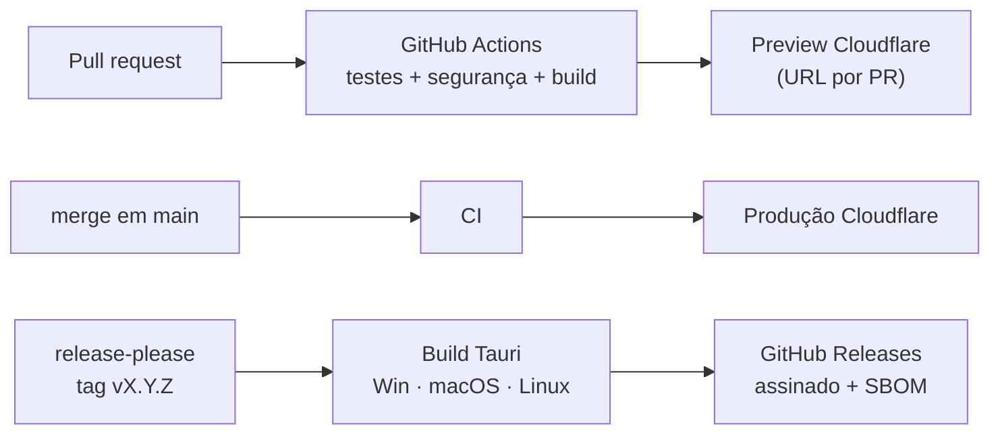
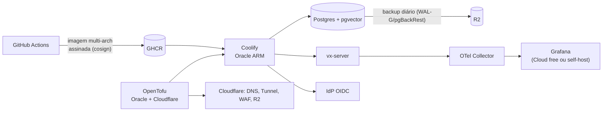

# Ambientes e deploy

Responsável: agente `devops-engineer`. Pipeline em [ci-cd.md](ci-cd.md); custos e limites em
[infra-free-tier.md](infra-free-tier.md).

## Ambientes

| Ambiente | Fases | O quê | Onde |
| -------- | ----- | ----- | ---- |
| **local** | todas | `pnpm dev`, `pnpm desktop:dev`, `cargo test`; F3: `docker compose up` (Postgres, IdP, `vx-server`) | máquina do dev |
| **preview** | F0+ | Site estático por PR, URL única; F3: API efêmera com banco descartável | Cloudflare (Pages/Workers static assets) |
| **produção** | F0+ | Site estático em `main`; releases do desktop; F3: API + banco | Cloudflare + GitHub Releases; F3: Oracle ARM |

Não existe "staging" separado até a F3: o preview por PR cumpre esse papel.

## Fases 0–2: só estático

- Build: `pnpm wasm:build && pnpm -C apps/web build` → `apps/web/build/` (adapter-static).
- Cabeçalhos de segurança versionados (`_headers`): CSP, HSTS, `X-Content-Type-Options`,
  `Referrer-Policy`, `Permissions-Policy`, COOP.
- Domínio: subdomínio gratuito (`*.pages.dev`) até haver domínio próprio.

## Fase 3: servidor

- **Imagens**: Dockerfile multi-stage, base distroless/`cgr.dev` ou `debian-slim`, usuário não
  root, `linux/arm64` + `linux/amd64`, SBOM e assinatura.
- **Rede**: nenhuma porta pública além de SSH restrito; tráfego entra por **Cloudflare Tunnel**.
- **Migrações**: `sqlx migrate` no deploy, sempre compatíveis com a versão anterior (expand/contract).
- **Backups**: diário + WAL contínuo para R2, criptografado; teste de restauração mensal (automatizado).
- **Recuperação**: tudo em OpenTofu + Coolify, então o ambiente pode ser recriado em outro provedor
  (Hetzner, Fly, outro tenant Oracle) se a cota mudar.
- **Observabilidade**: logs, métricas e traces (OpenTelemetry), painéis de latência/erros e alertas
  por e-mail/Discord.

## Rotina de releases
- Versionamento semântico a partir de Conventional Commits (já adotados) com **release-please**.
- `CHANGELOG.md` gerado; release do desktop com instaladores assinados e atualizador Tauri.
