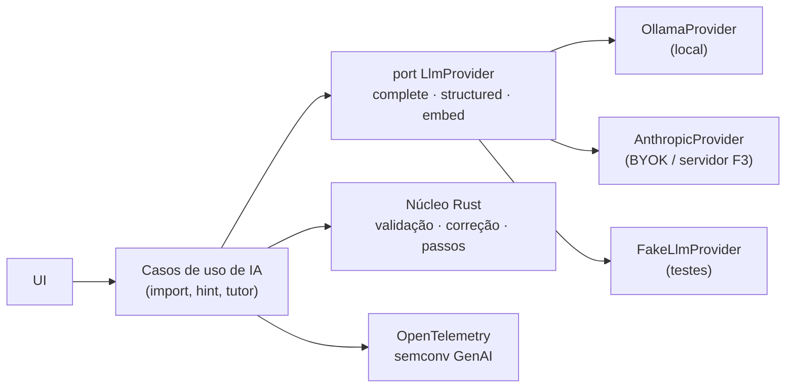

# Estratégia de IA

Responsável: agente `ai-engineer`. Riscos: [modelo de ameaças](../06-seguranca/modelo-de-ameacas.md#t4t5--llm-f2)
e [OWASP LLM Top 10](../06-seguranca/owasp.md#owasp-top-10-for-llm-applications-2025).

## Princípios
1. **O motor calcula, o LLM explica.** Correção, derivadas, limites e passos vêm do núcleo Rust. O
   LLM organiza texto, extrai estrutura e conduz o raciocínio. Ele nunca decide se uma resposta
   está certa.
2. **Ensinar, não resolver.** Dicas e tutor seguem o método socrático: uma pergunta ou passo por
   vez, sem entregar a resposta antes de uma tentativa. É o mesmo combinado do agente-professor de POO.
3. **Local primeiro, nuvem opcional.** Ollama como padrão sugerido; Claude/outros via chave do
   usuário (BYOK) ou, na F3, pelo servidor com cota.
4. **Avaliar antes de lançar.** Toda funcionalidade de IA tem um conjunto de avaliação versionado e
   métricas mínimas na CI.
5. **Dado privado não sai sem permissão.** Conteúdo `private` só vai para provedor externo com
   confirmação explícita por ação.

## Arquitetura

- `LlmProvider` é um port como os outros (Clean Architecture). Os testes usam `FakeLlmProvider`.
- *Structured output* com o **JSON Schema gerado dos tipos Rust** ([ADR 0008](../03-arquitetura/adr/0008-formato-canonico-de-exercicio.md)).
- Telemetria opcional com as convenções GenAI do OpenTelemetry. Langfuse self-host é possível,
  mas pesado (Postgres + ClickHouse + Redis + storage), então fica para quando houver servidor.

## Funcionalidades

### 1. Importador de PDF assistido (F2)

- **Checagem pelo motor**: se o enunciado diz "derive `x³e^x`" e o gabarito diz `x²eˣ(x+3)`, o motor
  deriva e compara. Divergência = provável erro de OCR ou de extração, e o item é marcado para revisão.
- OCR local (Marker: melhor nota geral no olmOCR-bench; MinerU: fórmulas em LaTeX, Apache 2.0) ou
  LLM com visão. Escolher com o conjunto de avaliação abaixo.
- **Avaliação**: as 5 listas de Cálculo A com gabarito (pack privado, local, fora da CI pública).
  Métricas:
  - precisão por campo (enunciado, tipo de resposta, resposta);
  - % de itens auto-corrigíveis;
  - % de divergências motor × gabarito;
  - tempo e custo por página.

### 2. Dicas e tutor socrático (F2)
- Entrada: exercício + resposta do estudante + **passos do motor** (ex.: regras da derivada).
- Saída: uma dica por vez, no nível pedido (ideia → próximo passo → quase a resposta).
- Guardrails: o texto passa por um filtro que bloqueia a resposta final antes da tentativa (compara
  com o `AnswerSpec` usando o próprio corretor).
- Avaliação: rubrica (não revela a resposta, está correta segundo o motor, é curta) com LLM-as-judge
  + amostra revisada por humano. promptfoo na CI com casos fixos.

### 3. Servidor MCP `vertice-mcp` (F2)
- Binário Rust que expõe comandos do `dispatch` (derivar, limite, sistema linear, checar resposta)
  e a busca no banco público como **ferramentas MCP**.
- Uso: Claude Code/Desktop e outros clientes podem usar o motor da Vértice durante o estudo, ou os
  agentes de desenvolvimento podem validar exercícios.
- Somente leitura e cálculo (OWASP LLM06).

### 4. Busca semântica e deduplicação (F2+)
- Embeddings dos enunciados para "exercícios parecidos" e para detectar duplicatas ao importar.
- Local: `transformers.js` + índice em memória/`sqlite-vec`; F3: `pgvector`.
- Índices público e privado separados (OWASP LLM08).

### 5. Caderno de erros inteligente (F2+)
- Agrupa tentativas erradas por habilidade e por padrão de erro (o feedback de erro comum que casou)
  e sugere a revisão. É o "erros que cometi" automatizado.

## Execução de código

Exercícios de programação (F2) precisam rodar código do estudante com segurança:

| Linguagem | Opção | Observações |
| --------- | ----- | ----------- |
| JavaScript/TypeScript | Web Worker + iframe `sandbox` | Gratuito, offline |
| Python | Pyodide (WASM) em Worker | ~10 MB, offline após cache |
| SQL | sqlite-wasm ou PGlite | Ótimo para Banco de Dados |
| **Java (POO)** | **Em aberto.** Opções: (a) desktop usa o JDK local via comando Tauri com confirmação; (b) Java compilado para WASM/JS no navegador (TeaVM, CheerpJ — verificar licença e se compila código-fonte no cliente); (c) judge no servidor na F3 (Judge0 ou wrapper próprio com nsjail/gVisor) | Decidir com um spike na F2. Até lá, exercícios de Java são `self_graded` + revisão por IA com rubrica |

## Custos
- Desenvolvimento e avaliação: Ollama local (gratuito) + créditos/BYOK para comparar com modelos
  maiores.
- Produção F2: só local/BYOK. F3: cota por usuário no servidor, com orçamento mensal e corte automático.
